# Decision diagrams

One diagram per decision in `decisions/`. Superseded decisions are kept and marked, not
deleted: the trail is the point.

| ID | Decision | Status |
|---|---|---|
| D-001 | Grouping and instantiation are different operations | active |
| D-002 | Run state is separate from host Blockie state | active |
| D-003 | Composites may be static; two state dimensions (amended by D-018) | active |
| D-004 | Explicit state, minimal implicit machines (with two bounds) | active |
| D-005 | Every managed process is represented | **superseded by D-013** |
| D-006 | Geometry is semantically inert | active |
| D-007 | One World, global placement, views are cameras | active |
| D-008 | Representation is stage/backstage | **superseded by D-013** |
| D-009 | Attention is derived, not an entity | active |
| D-010 | Status is a projection with many dialects | active |
| D-011 | Declared graph, not runtime signal tracking | active |
| D-012 | Aggregation is declared; implicit fan-in stays forbidden | active |
| D-013 | Host is mandatory, placement is nullable | active |
| D-014 | Primary status is derived, never declared | active |
| D-015 | A Composite interface is an alias table | active |
| D-016 | Claim routing decides reducer versus run | active |
| D-017 | Host output ports declare their producer | active |
| D-018 | Management grants dispatch, nothing else | active |
| D-019 | One status chain: registry, mode, display | active |
| D-020 | Value equality is typed | active |
| D-021 | Inputs resolve from the staged generation | active |
| D-022 | Hierarchical local coordinates; translation and uniform scale | active |
| D-023 | Placement operations are atomic | active |
| D-024 | Camera and grant scope are unrelated | active |
| D-025 | Fork rewrites provenance; save-as captures structure only | active |
| D-026 | Empty Composites dissolve; folds revalidate | active |
| D-027 | JS/TS first, WASM second, no native libraries | active |
| D-028 | Terminology and retention | active |
| D-029 | Process phase scheduling and failure classes | active |
| D-030 | Runs never observe mid-transaction values | active |
| D-031 | Attention is bindings ∪ sessions | active |
| D-032 | Dispatch is not a Composite alias source | active |
| D-033 | The dispatch endpoint is a grant, not a port | active |
| D-034 | Absence encodes unplaced and dissolved | active |
| D-035 | Composite presentation is a record, not a Blueprint | active |
| D-036 | Chrome is never interactive | active |
| D-037 | A Composite's own appearance is static per revision | active |
| D-038 | Members draw above the assembly; layer orders members | active |
| D-039 | The step result is a three-way outcome | active |
| D-040 | The step context includes host configuration, never host state | active |
| D-041 | Repair is limited to dangling designation | active |
| D-042 | Policy is a template in the World; bindings are session state | active |
| D-043 | Four verbs, three scopes, deny by default | active |
| D-044 | Authority is checked once, at the boundary | active |
| D-045 | The file holder is not governed by policy | active |

## Lineage

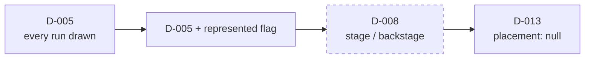

## D-001 — Grouping and instantiation

Ad-hoc grouping is mutable and keeps identities. Instantiation materialises fresh identities
and is immutable. `save as` promotes a grouping to a definition; `fork` demotes an instance
back to a grouping.

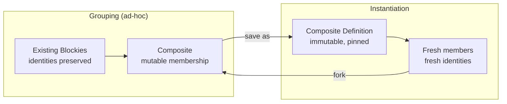

## D-002 — Run state is separate from host Blockie state

The run never writes the host's state. It publishes through declared bindings; it reads through
declared inputs. One writer per state, always.

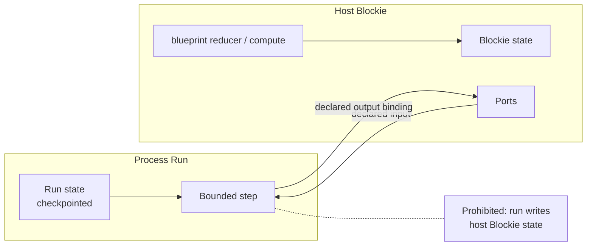

## D-003 — Composites may be static

Three independent dimensions. Collapsing them into one enum is the conflation the rest of the
architecture forbids.

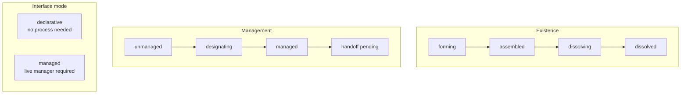

## D-004 — Explicit state, with two bounds

State that carries transition authority is stored. Everything else is a projection or view
ephemera.

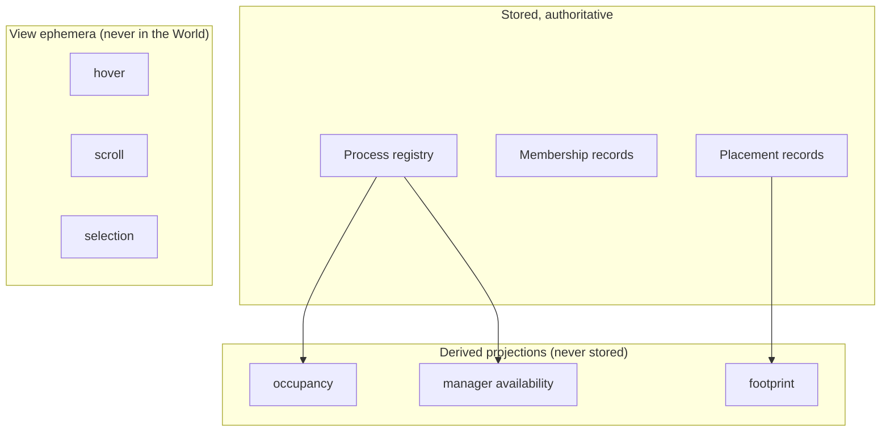

## D-005 — Every managed process is represented

Superseded. The intent survived; the mechanism did not: a boolean flag became stage/backstage,
which became nullable placement. See the lineage diagram.

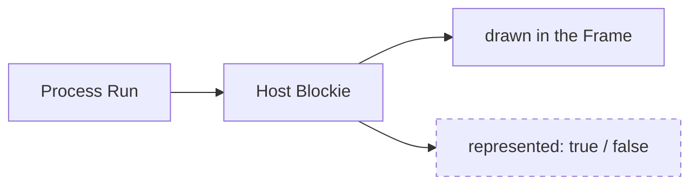

## D-006 — Geometry is semantically inert

Placement may influence what you see. It may not influence what happens.

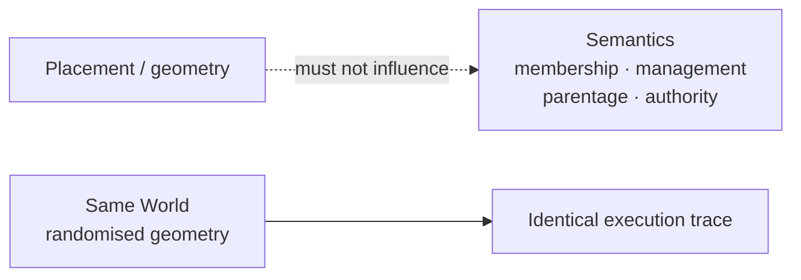

## D-007 — One World, global placement, views are cameras

Four distinct entities in the two-view scenario. The green buttons drive the beige composites by
connection, not by identity. A view is a viewport plus renderer plus grants.

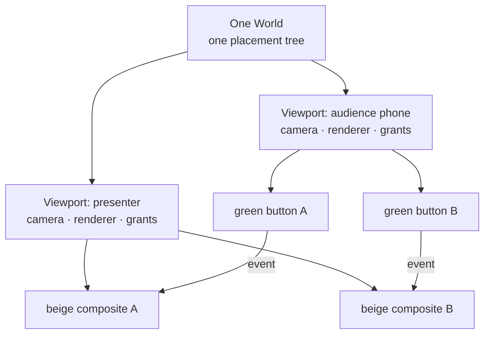

## D-008 — Representation is stage/backstage

Superseded by D-013. Kept because it is the step where "not drawn" stopped being a run state.

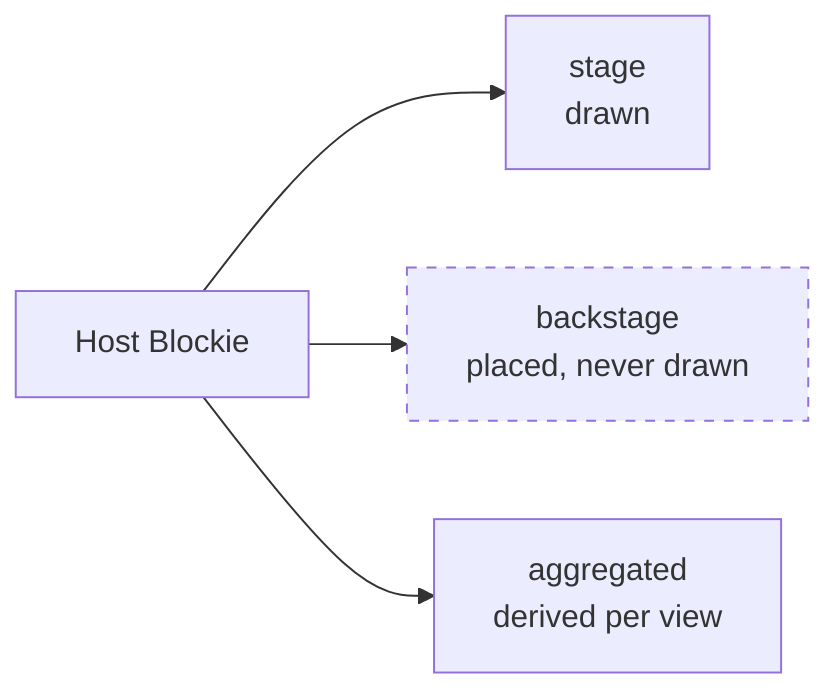

## D-009 — Attention is derived, not an entity

Who is looking is a function of sessions. No second truth about who is working on what.

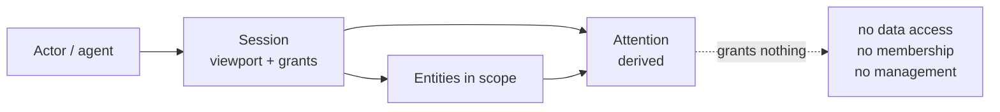

## D-010 — Status is a projection with many dialects

One internal projection, N exporters. Egress only: reading a dialect back would be an ambient
dependency.

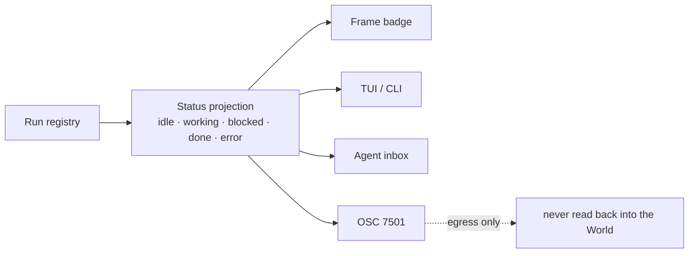

## D-011 — Declared graph, not runtime signal tracking

The value graph is a signal graph whose edges are declared rather than discovered. That is what
makes it serialisable and validatable.

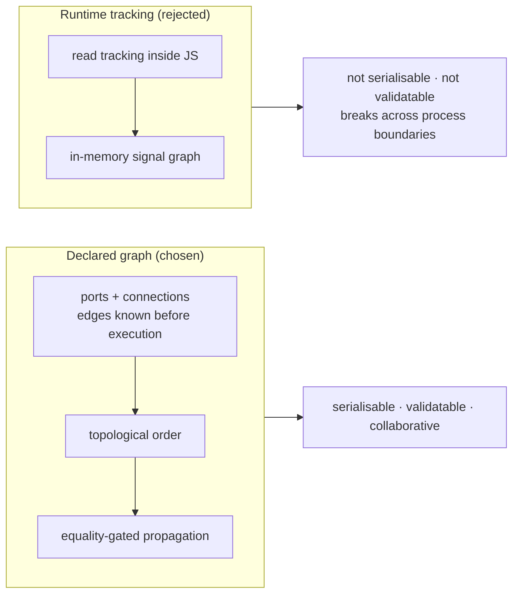

## D-012 — Aggregation is declared

Fan-out is free. Fan-in is forbidden because the combining rule would be implicit. A fold makes
it explicit, with no process and no shared state.

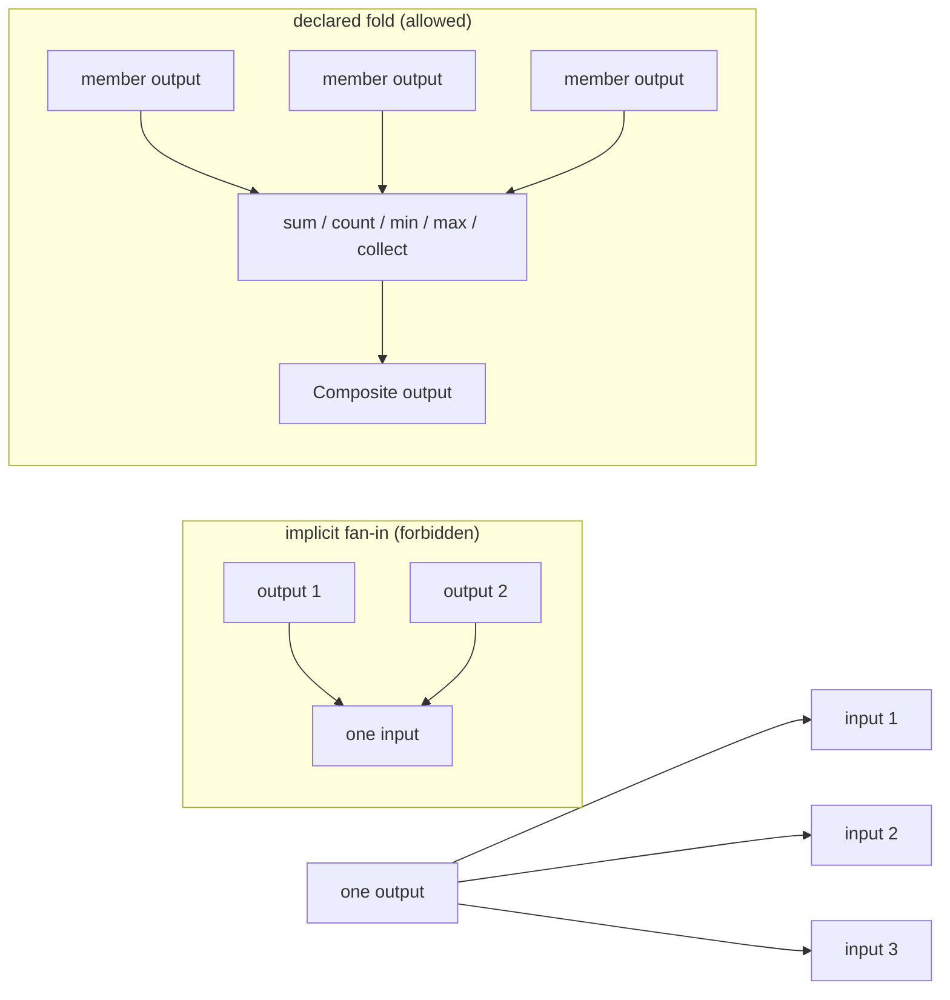

## D-013 — Host is mandatory, placement is nullable

The host is the run's interface, not its picture. Promotion and demotion are placement
operations: reversible, identity-preserving, no capability change.

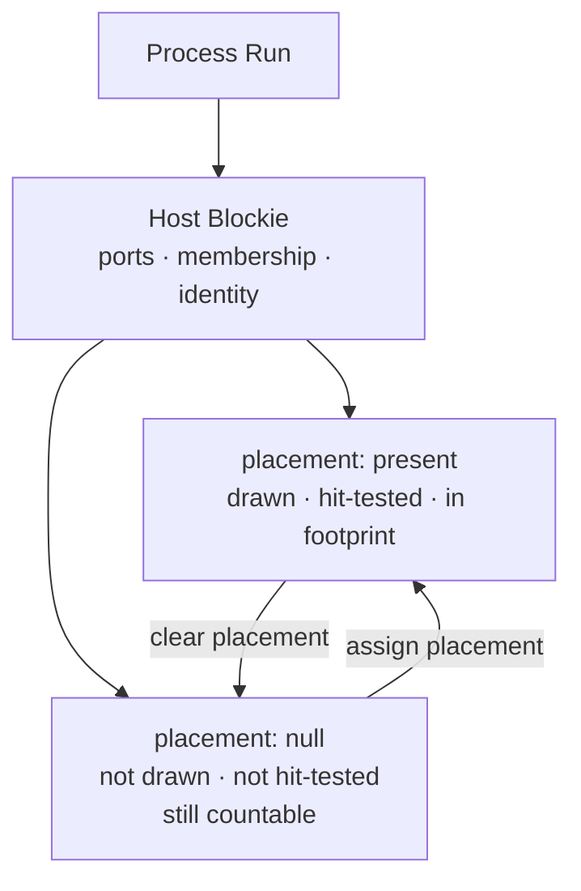

## D-014 — Primary status is derived, never declared

A claim can be wrong; an observation cannot. Sub-phases are a label on top, never the truth.

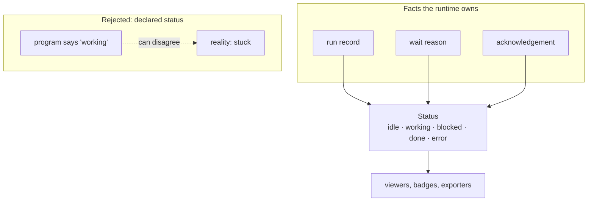

## D-015 — A Composite interface is an alias table

Aliases point at things that already exist. They have no state, so there is no second port
system and nothing to keep in sync.

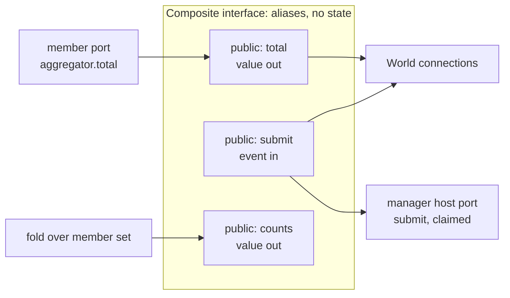

## D-016 — Claim routing decides reducer versus run

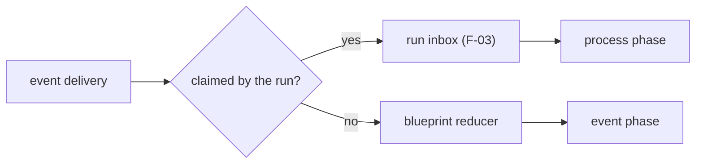

## D-017 — Host output ports declare their producer

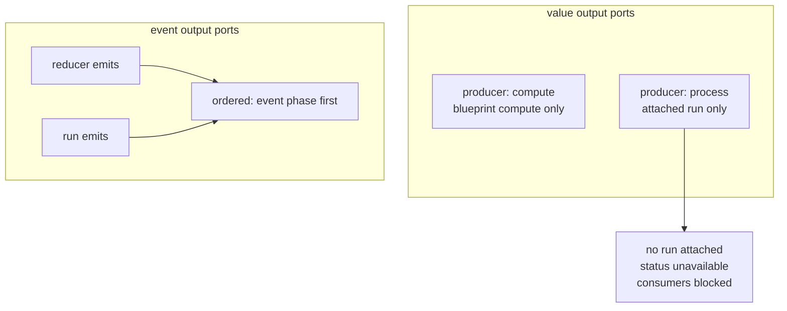

## D-018 — Management grants dispatch, nothing else

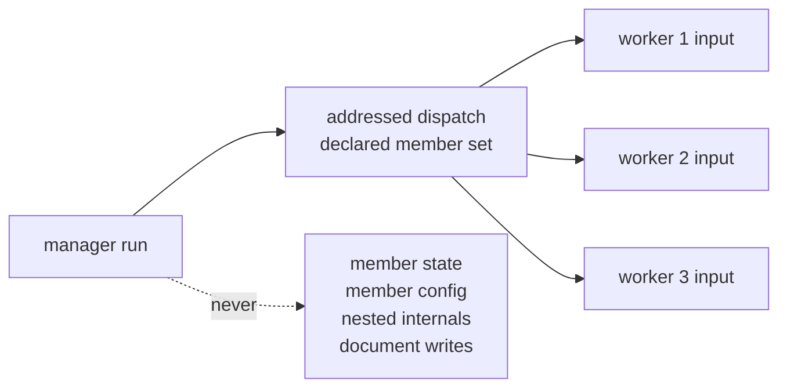

## D-019 — One status chain

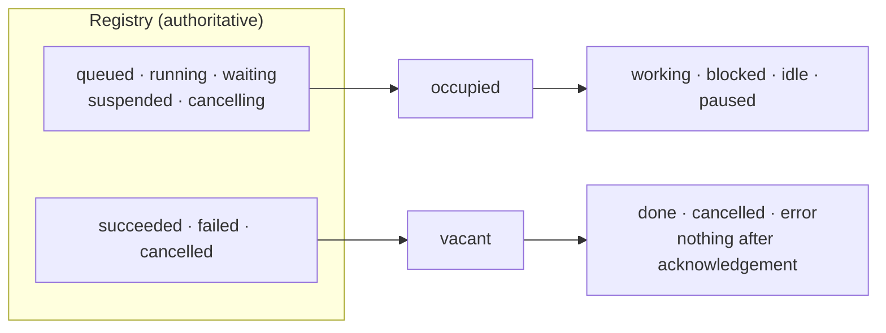

## D-022 — Hierarchical local coordinates

```mermaid
flowchart TB
    W["World Frame<br/>root scope"]
    C["Composite transform<br/>translation + uniform scale"]
    B1["member placement<br/>local to the Composite"]
    B2["member with placement: null"]
    W --> C
    C --> B1
    C --> B2
    B2 --> F["empty footprint<br/>not drawn, still a member"]
```

## D-024 — Camera and grant scope are unrelated

```mermaid
flowchart LR
    V["View"] --> CAM["Camera<br/>spatial framing"]
    V --> G["Grant scope<br/>explicit entities · ports · verbs"]
    CAM -. "confers nothing" .-> G
    G --> A["audience: deliver events to buttons A and B only"]
```

## D-027 — Two plugin surfaces, no native libraries

```mermaid
flowchart TB
    D["Definition plus module"] --> JS["JS/TS adapter<br/>QuickJS or Boa<br/>bounded step"]
    D --> WASM["WASM adapter<br/>Rust · physics · hot paths"]
    JS --> RT["Runtime"]
    WASM --> RT
    RT --> REN["Renderer package<br/>presentation plugin"]
    X["Native libraries"] -. "never" .-> RT
```

## D-029 — Process phase scheduling

```mermaid
flowchart LR
    EP["event phase<br/>reducers, FIFO"] --> PP["process phase<br/>ready runs, FIFO<br/>one step per run"]
    PP --> VP["value phase"]
    PP -. "already stepped → defer" .-> NX["next transaction"]
```

## D-030 — Runs never observe mid-transaction values

```mermaid
flowchart LR
    T["transaction N<br/>event → process → value"] --> W["value change satisfies<br/>a dependency condition"]
    W --> S["step scheduled"]
    S --> T2["transaction N+1<br/>run reads one coherent generation"]
```

## D-031 — Attention is bindings ∪ sessions

```mermaid
flowchart LR
    A["external actor"] --> S["session viewport + grants"]
    R["in-world run"] --> B["declared input bindings"]
    S --> AT["attention"]
    B --> AT
    AT -. "grants nothing" .-> X["no membership · no management · no access"]
```

## D-032 / D-033 — Dispatch is a grant, not an endpoint

```mermaid
flowchart LR
    R["manager run"] --> G["grant<br/>composite + memberSet"]
    G --> V{"target in memberSet?"}
    V -- "yes" --> M["member event input"]
    V -- "no" --> X["rejected"]
    A["Composite aliases"] -. "never expose dispatch" .-> X
```

## D-035 / D-038 — What draws a Composite, and in what order

```mermaid
flowchart TB
    subgraph S["Composite scope"]
        CH["chrome / body surface<br/>not interactive"]
        M1["member, layer 0"]
        M2["member, layer 2"]
        M3["member, layer 2<br/>tie broken by id"]
    end
    CH --> M1
    M1 --> M2
    M2 --> M3
    P["presentation record<br/>label · renderer? · body?"] -. "describes, never computes" .-> CH
    X["styling, typography"] -. "renderer package" .-> CH
```

## D-042 / D-044 — Where authority lives, and when it is checked

```mermaid
flowchart LR
    subgraph W["World document (portable)"]
        P["policy: roles + grants<br/>deliver · read · mutate · run"]
    end
    subgraph H["Host session (deployment)"]
        PR["principal"]
        B["role bindings"]
        C["camera + grant scope"]
    end
    E["external event"] --> CHK{"authorised at entry?"}
    P --> CHK
    B --> CHK
    CHK -- "no" --> X["rejected, nothing staged"]
    CHK -- "yes" --> I["internal routing<br/>alias · forward · dispatch<br/>not re-checked"]
```
