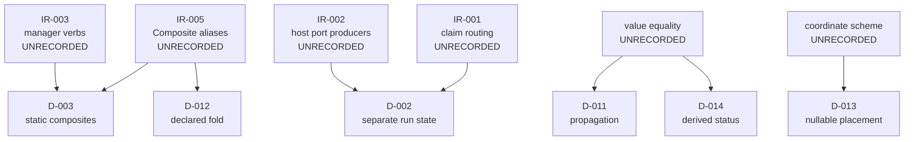

# Integrity check 0001

**Date:** 2026-11-16
**Scope:** `decisions/0001`–`0003`, `architecture/layers.md`, `architecture/fsm-inventory.md`,
`architecture/decision-diagrams.md`, cross-checked against the handoff ontology and the v0.1
legacy family.
**Method:** every decision checked against every other decision, against the inventory, and
against the handoff invariant it amends.

## Verdict

The ontology holds. No finding reverses the entity/relationship model, and no two decisions
contradict each other outright.

The inconsistencies are at three seams:

1. **Four accepted decisions rest on decisions that were never recorded.** D-002, D-003 and
   D-012 all assume resolutions to handoff items IR-001, IR-002, IR-003 and IR-005 that exist
   only in conversation.
2. **Two decisions contain definitional errors** (D-003 on independence, D-003 vs D-012 on what
   "declarative" means).
3. **One supersession left debris** (D-013 retired the representation flag but F-01 still
   carries it, and F-15 still exists as an entity after D-009 deleted it).

Nothing here blocks writing traces. Four findings block writing schemas.

## Findings

| ID | Sev | Finding | Where | Resolution |
|---|---|---|---|---|
| I-001 | P0 | Attention is deleted as an entity by D-009, but F-15 still lists it as a protocol FSM. D-009's derivation (sessions) also cannot explain an in-world supervisor, which observes through process input bindings, not a session. | D-009, F-15, handoff Scenario C | Withdraw F-15; define attention as a projection over **session scopes ∪ process input bindings** |
| I-002 | P0 | D-003 calls existence, management and interface mode "three independent dimensions". They are not: interface mode `managed` requires management ≠ `unmanaged`. | D-003 | Two independent dimensions plus one constrained by management |
| I-003 | P0 | D-003 defines a declarative interface as "aliases and bindings, no computation". D-012's fold is computation with no process. | D-003, D-012 | Declarative means "no manager, no process"; protocol-provided folds are not user computation |
| I-004 | P0 | F-01's projection still exposes a "representation flag". D-013 replaced it with nullable placement. | F-01 | Replace with `placement: present \| null` |
| I-005 | P0 | F-04 and F-19 are listed as protocol FSMs but described as derivable, which violates D-004's own bound. | F-04, F-19, D-004 | Split the taxonomy: entity lifecycles, operation lifecycles, published projections |
| I-006 | P0 | The status mapping in D-010/D-014 omits `suspended`, `cancelling` and `cancelled`. | D-010, D-014, F-01 | Complete the projection table; decide whether `suspended` maps to `idle` or a sixth word |
| I-007 | P0 | Composite ports as aliases (IR-005) is never recorded, yet D-003 (declarative interface) and D-012 (fold outputs) both presuppose it. | D-003, D-012 | Record the alias model as a decision |
| I-008 | P0 | Process input dispatch / claim routing (IR-001) is never recorded, yet D-002 depends on knowing whether a claimed input reaches the reducer or the run. | D-002 | Record claim-based routing |
| I-009 | P0 | The producer rule for host output ports (IR-002) is never recorded, yet D-002 publishes into host ports that a Type Compute may also produce. | D-002 | Record exclusive process-writable port declarations |
| I-010 | P0 | The manager verb set (IR-003) is undefined, yet D-003's `managed` mode depends on it. | D-003 | Enumerate `composite.manage` capabilities |
| I-011 | P1 | F-05's recovery rule assumes a pinned template always exists. After a fork (D-001) it does not. | F-05, D-001 | Condition the provenance check on the presence of a pinned template |
| I-012 | P1 | `save as` semantics are undefined: does it capture member state, config, or structure only? What happens to nested ad-hoc composites? | D-001 | Definitions capture structure and config; never member state; nested ad-hoc composites must be saved recursively or flattened |
| I-013 | P1 | The existence dimension does not encode "a committed Composite has at least one member". | D-003, F-06 | Encode emptiness: removing the last member dissolves |
| I-014 | P1 | A viewport is undefined (rectangle vs entity set), yet grants are scoped to it. | D-007, F-13 | Define viewport as an explicit entity-set selector plus a camera |
| I-015 | P1 | A fold ranges over "a named set of member outputs". Membership is mutable in a grouping, so the set changes; revalidation is undefined. Nested ranges are undefined. | D-012 | Revalidate folds on membership change; allow nested public outputs |
| I-016 | P1 | Value equality is undefined, yet D-011's propagation gating and D-014's `done` state depend on it. | D-011, D-014 | Adopt the legacy review's recommendation and specify per-type equality |
| I-017 | P1 | Input resolution (staged vs committed generation) is still unrecorded. | D-011, legacy P0-2 | Record staged resolution |
| I-018 | P1 | Hierarchical local coordinates remain unratified, and `placement: null` is a third case the coordinate rule must cover. | D-006, D-013, handoff §5 | Ratify hierarchical local coordinates with an explicit null case |
| I-019 | P1 | F-17 covers move and reparent but not D-013's assign/clear placement. | F-17, D-013 | Add promotion and demotion transitions |
| I-020 | P1 | Three vocabularies describe the same registry: operational mode, run state, display status. No canonical layering, and the mode naming (`drawing`/`computing`) was challenged but never decided. | D-014, F-01, handoff §2.2 | Define registry → mode → display status as one chain; settle mode naming |
| I-021 | P1 | Consequence not stated: if a run claims all host inputs, the host's Model State is frozen for the run's lifetime. | D-002 | State it as an explicit consequence and test it |
| I-022 | P1 | The language/engine choice (JS/TS, QuickJS/Boa) exists only as prose in layers.md, not as a decision, yet the plugin system and the ABI depend on it. | layers.md | Record it as a decision |
| I-023 | P2 | F-20 is listed after F-21 and F-22. | F-15 area | Cosmetic; reorder when next edited |
| I-024 | P2 | D-010 and D-014 overlap by roughly 80%. | D-010, D-014 | Cross-reference; do not merge (0002 and 0003 are append-only) |
| I-025 | P2 | F-01's projection omits acknowledgement, which `done` requires. | F-01 | Add it |
| I-026 | P2 | F-12 says definitions are "published"; D-001 says agent-authored definitions are "embedded in the World manifest". | F-12, D-001 | Separate registry publication from World embedding |
| I-027 | P2 | The handoff states every Blockie has "a placement in a Frame". D-013 amends that. | handoff §2.1 | Add a cross-repo amendment note |
| I-028 | P2 | Retention of historical run state (multiple terminal runs per host) is undefined. | F-01, handoff §2.4 | Define archival and retention |

## Dependency graph

Accepted decisions resting on unrecorded ones are the highest risk, because they look settled
and are not.

## Resolution order

1. **Record the four unrecorded decisions** (I-007, I-008, I-009, I-010). Six accepted
   decisions stop being load-bearing on conversation.
2. **Fix the two definitional errors** (I-002, I-003). Both are one-paragraph amendments.
3. **Complete the status mapping** (I-006) and settle the three-vocabulary layering (I-020).
4. **Clear the debris** (I-001, I-004, I-005). Small, mechanical, removes the remaining
   contradictions.
5. **Resolve the P1 gaps during trace writing.** Each trace will force a decision on
   coordinates, equality, resolution generation, fold revalidation, and viewport scope.
6. P2 whenever the file is next touched.

## Fixed during this check

- F-15 withdrawn and moved to the derived projections table (I-001, partial — the projection
  definition still needs the union with process input bindings).
- F-01's projection no longer exposes a representation flag; it exposes acknowledgement and
  placement present/null (I-004, I-025).

## Resolution log

| Finding | Resolved by | How |
|---|---|---|
| I-002 | 0004, amendment to D-003 | `interface_mode` deleted as redundant; two dimensions remain; F-08 withdrawn |
| I-003 | 0004, amendment to D-003 | "declarative" = no manager and no process; folds are protocol evaluation |
| I-007 | D-015 | Composite interface is an alias table with no state |
| I-008 | D-016 | Claim routing; inputs are reducer-owned or run-owned, never both |
| I-009 | D-017 | Every value output declares `producer: compute \| process` |
| I-010 | D-018 | One verb: `composite.dispatch`, bounded by a declared member set |
| I-004 | fixed in place | F-01 projection corrected |
| I-001 | partial | F-15 withdrawn; projection still needs sessions ∪ bindings |

Still open: I-006, I-011 through I-022.

## Second resolution log

| Finding | Resolved by | How |
|---|---|---|
| I-006 | D-019 | Seven-word display vocabulary; `suspended` and `cancelled` represented |
| I-011 | D-025 | F-05 provenance check conditioned on a pinned template |
| I-012 | D-025 | Save-as captures structure and config, never state; recursive save |
| I-013 | D-026 | Removing the last member dissolves the Composite |
| I-014 | D-024 | Camera and grant scope are separate; authority never spatial |
| I-015 | D-026 | Fold revalidates on membership change; empty-set rule |
| I-016 | D-020 | Typed equality table |
| I-017 | D-021 | Staged resolution recorded |
| I-018 | D-022 | Hierarchical local coordinates; translation and uniform scale; null case |
| I-019 | D-023 | Full placement operation set |
| I-020 | D-019 | Registry → mode → display chain; mode renamed occupied/vacant |
| I-021 | D-019 | Frozen-host consequence stated and testable |
| I-022 | D-027 | Language, engine, adapter rules, plugin surfaces recorded |
| I-023 | pending | F-20 ordering is cosmetic; fix on next edit |
| I-024 | D-019 | Cross-referenced; 0002/0003 remain append-only |
| I-025 | fixed | F-01 projection carries acknowledgement |
| I-026 | D-028 | Published vs embedded defined |
| I-027 | D-028 | Handoff amendment note recorded |
| I-028 | D-028 | Retention and archival defined |

All findings closed except I-023 (cosmetic ordering).
