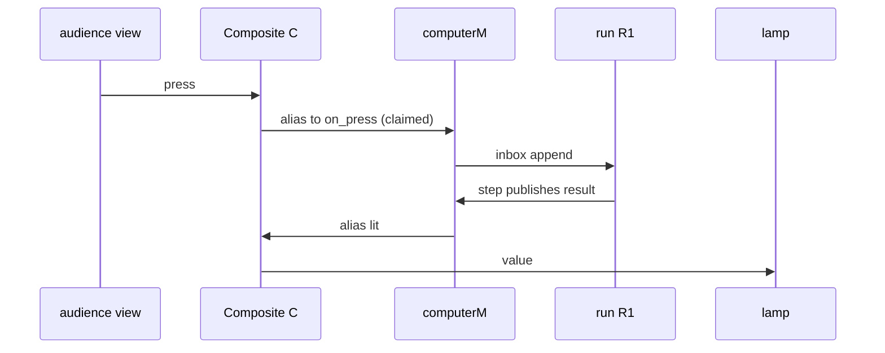
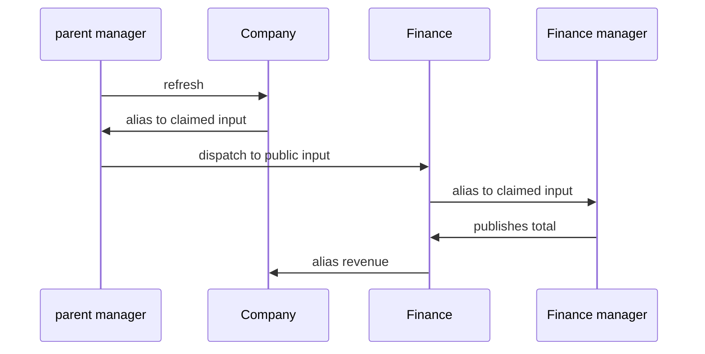

# Reference traces

**Status:** Working draft
**Purpose:** force the schemas. Each trace is a transaction log: what is accepted, what runs in
which phase, and what commits as one generation. Where a trace exposes a gap, it is listed at the
end rather than patched silently.

Format:

```
T<n> — name
  accepted    what entered the runtime, under whose grant
  validated   what had to resolve for it to be legal
  event phase reducers only, FIFO
  process     run steps, FIFO, at most one per run
  value       stabilisation, staged inputs
  commit      what becomes one generation
  publish     what viewers see
  effects     post-commit
```

## Trace A — the button

### Setup

**T0a — assemble (document transaction).** Create `pixelA`, `pixelB` (Drawing members) and
`computerM` (Computing-capable), all placed. Create Composite `C` with membership edges to all
three, provenance `grouping`. `C` starts unmanaged.

**T0b — attach and designate (one document transaction).** Create run `R1` against
`computerM`, definition `D_press`, `claims: [on_press]`, `publishes: [result]`. Attach `R1`.
Designate `computerM` as manager. Validation: the manager is a direct member, is occupied, the
Type declares `on_press` claimable and `result` process-produced. Commit one document revision.
The grant `composite.dispatch` is held by `R1`, member set `{pixelA, pixelB}`.

**T0c — declare the interface (document transaction).** Aliases on `C`:

| Public | Direction | Kind | Source |
|---|---|---|---|
| `press` | in | event | `computerM.on_press` |
| `lit` | out | value | `computerM.result` |
| `pulse` | out | event | `computerM.on_pulse` |

Connect `C.lit` → `lamp.lit`.

### T1 — press

```
accepted    event press → C.press
            actor: audience session
            grant scope: deliver press on C.press only
validated   alias → computerM.on_press; kind event; payload type matches;
            input is claimed by R1
event       delivery reaches on_press; claimed, so no reducer runs;
            appended to R1 inbox (F-03); R1 waiting → running
process     R1 step with inbox [press]
            returns outputs { result: true }, wait: inbox
            run state checkpointed; R1 running → waiting (reason: inbox)
value       computerM.result changed → C.lit → lamp.lit → lamp compute
commit      run record, run state, computerM.result, lamp output — generation N+1
publish     R1 idle; lamp lit
effects     none
```



### T2 — the manager fails

A second press arrives; the step throws.

```
accepted    event press → C.press
event       inbox append; R1 waiting → running
process     R1 step throws
            step failure is run-local: R1 → failed, transaction continues
value       computerM.result → unavailable (no run)
            C.lit → unavailable
            lamp.lit receives unavailable, not a stale value → lamp blocked
commit      ONE generation containing:
              run failed, computerM vacant, manager designation cleared,
              C management → unmanaged, dispatch grant revoked,
              computerM.result unavailable, lamp blocked
publish     computerM vacant; C unmanaged; lamp blocked badge
```

This is IR-004 made concrete. Splitting any one of those five effects into a second transaction
would leave a Composite claiming a manager that no longer exists.

## Trace B — one Composite, multiple Computers

### Setup

`C` contains manager `computerM` and workers `computerW1`, `computerW2`. Each hosts its own run
(`R1`, `RW1`, `RW2`). `R1` holds `composite.dispatch` with member set `{computerW1, computerW2}`.
`computerW1.out` and `computerW2.out` are connected to `computerM.in`.

### T1 — delegate

```
accepted    event task → C.task
event       alias → computerM.on_task (claimed) → R1 inbox
process     R1 step decides the target is W2 and emits
              { to: computerW2, payload: {...} } on its dispatch endpoint
            dispatch creates a NEW event (new id, causation = the task event)
            target is validated against the declared member set
            computerW2.on_task is claimed → RW2 inbox
            RW2 has not stepped in this transaction → RW2 steps next in the FIFO
            RW2 step publishes to computerW2.out
value       computerW2.out → computerM.in (staged)
            R1 has already stepped, so it is NOT re-run in this transaction
commit      one generation
```

Two rules are doing the work here, and neither was recorded before this trace:

1. the process phase has its own FIFO, and a run may step **at most once per transaction**;
2. a run that becomes ready after it has already stepped is deferred to the next transaction.

### T2 — completion follow-up

```
accepted    scheduled wake: RW2 emitted completed → computerM.inbox
process     R1 step with the completion in its inbox
commit      generation N+2
```

The manager's second step is a separate transaction, not a re-entry. That is what keeps the
process phase bounded and prevents a dispatch loop from running forever inside one commit.

## Trace C — standalone supervisor

`S` is standalone: no Composite membership, placed anywhere, hosting `R_s`. Its input ports are
connected to `C_A.lit` and `C_B.lit`. `R_s` declares a wake condition with reason `dependency` on
those inputs.

### T1 — watch A

```
accepted    event watch → S.watch (grant: deliver watch on S.watch)
event       claimed → R_s inbox
process     R_s step reads inputs { A: ..., B: ... } — both are declared input ports,
            not private state; no Composite authority is involved
commit      run state
```

`S` remains standalone. Moving it next to `C_A` is a separate placement operation (D-023) and
changes nothing here.

### T2 — A changes

```
accepted    none — a wake condition is satisfied
process     the value phase of the producing transaction already ran,
            so R_s is scheduled for the NEXT transaction
process     R_s step with fresh inputs
commit      generation N+1
```

This is the ordering consequence worth stating: **a run can never observe a value change in the
same transaction that produced it.** That is glitch-freedom by construction, not a limitation.

Attention here is derived, not declared: `R_s` is "watching" exactly the entities whose outputs
its host's inputs are connected to. Union that with session scopes and I-001 is closed.

## Trace D — nested Composites

### Setup

`Company` contains `Finance` and `Ops` (both nested groupings, each with its own manager). Parent
manager `computerM` is a direct member of `Company`, not of `Finance`. `Company.revenue` is an
alias to `Finance.total`, which is itself an alias to a `Finance` member's port.

### T1 — parent asks the child to refresh

```
accepted    event refresh → Company.refresh
event       alias → computerM.on_refresh (claimed) → R1 inbox
process     R1 step dispatches { to: Finance, payload: {} }
            target is a direct member, so it is inside the declared member set
            the event arrives at Finance.refresh — a PUBLIC alias, never an internal port
event       Finance alias → Finance manager's claimed input → its inbox
process     Finance manager has not stepped in this transaction → it steps next
value       Finance.total changes → Company.revenue (alias chain resolves) → parent consumers
commit      one generation, both managers' state
```



### Assertions this trace must satisfy

- The parent manager cannot address a `Finance` internal port; validation rejects it.
- `Finance`'s manager cannot reach `Ops`; management is per-Composite.
- If `Finance`'s manager fails, `Finance` becomes unmanaged and `Company.revenue` becomes
  unavailable, but `Company`'s own designation is untouched — no cascade upward.
- External consumers of `Company.revenue` never see `Finance`'s member IDs; the boundary view
  reports `Company`.

## Findings

| Finding | Trace | Resolution |
|---|---|---|
| A run idle awaiting input has no wait reason | A | F-21 gains `inbox` |
| The process phase needs a scheduling rule | B | D-029 |
| A run cannot observe a value change in the same transaction | C | D-030 |
| Step failure classes (throw vs invalid result) | A, T2 | D-029 |
| Manager termination must be one atomic generation | A, T2 | confirmed; IR-004 satisfied by F-07 + D-018 |
| Attention is bindings ∪ sessions | C | D-031, closes I-001 |
| Nested alias chains resolve outward-in, with redaction | D | confirmed by D-015 |
| Dispatch targets a nested Composite's public alias | D | confirmed by D-018 |
