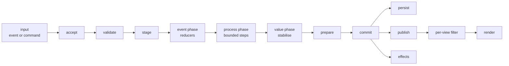

# 0001 — Performance bottleneck analysis

**Status:** Working draft
**Date:** 2026-11-19
**Covers:** every layer, A0–A6, plus cross-cutting representation and I/O
**Companions:** D-011 (`decisions/0002-views-and-status.md`), `architecture/layers.md`,
`specs/BCM-core-model.md`, `specs/BPS-process.md`, `specs/BCS-composite.md`

## 1. Purpose

This is a map of where a conforming implementation will be slow, why the architecture forces
that cost, and which technique removes it without changing what the system does. No engine
exists yet, so nothing here is a benchmark. Each cost is an order-of-magnitude argument from a
normative requirement, written so it can be checked against a real implementation later.

Two rules govern every recommendation:

1. **A fix may not change an observable trace.** If a technique changes the result of a
   transaction, it is not a fix. It is a semantic amendment and belongs in `decisions/`.
2. **A fix may not move authority.** Caching, indexing, batching and parallelism may change
   *when* work happens, never *who* may do it.

D-011 named nine levers: batch transactions, recompute only the dirty closure, suppress
unchanged values, memoise compute, share snapshot structure, flatten Composite boundaries,
parallelise independent nodes, make the sandbox call coarse, and use WASM for hot Types. Those
levers cover the value graph. They do not cover identity, document layout, persistence,
publishing, views, rendering, or operators. This document covers all of it and keeps D-011's
levers as the spine.

## 2. Cost model

### 2.1 Symbols

| Symbol | Meaning |
|---|---|
| `N` | Blockies in the World |
| `C` | Composites |
| `R` | Runs, including terminal runs retained for acknowledgement |
| `Rₐ` | Runs in a non-terminal state (the hot set) |
| `E` | Connections and alias entries |
| `F` | Folds |
| `G` | Nodes in the value graph (ports plus compute) |
| `V` | Live views or sessions |
| `D` | Containment depth |
| `W` | World document size in bytes |
| `P` | Ports per Type |
| `M` | Members per Composite |

### 2.2 Constants

Order-of-magnitude figures for a 2020s laptop or phone. They are here to make the arguments
checkable, not to be quoted as targets.

| Operation | Rough cost |
|---|---|
| L1 hit / L2 hit / L3 hit / DRAM | 1 ns / 4 ns / 20 ns / 80–120 ns |
| Branch mispredict | 5–15 ns |
| Hash-map lookup, warm | 20–50 ns |
| Pointer chase through an ID reference | 80–150 ns |
| String compare, short IDs | 5–20 ns |
| Linear scan of 10k entities | 10–100 µs |
| `memcpy` | 10–30 GB/s |
| `fsync` | 0.1–10 ms |
| Syscall | 0.5–2 µs |
| JS ↔ WASM call | 0.1–1 µs |
| Structured clone, small objects | 5–20 M objects/s |
| JSON parse | 100–400 MB/s |
| Generic JSON Schema validation | 1–10 MB/s |
| Compiled validator | 100 MB/s–1 GB/s |
| Draw call, CPU side | 1–10 µs |
| Text shaping and layout, per label | 10–100 µs |

### 2.3 The six hot paths

Everything below lands on one of these. The transaction path is the one the architecture is
really about; the others are where a naive implementation loses the frame budget or the disk.



| Path | Frequency | Bound by |
|---|---|---|
| 1. Ingest and transaction | per input, possibly 10²–10⁴/s | commit and validation |
| 2. Step execution | per run per transaction | sandbox boundary and interpreter |
| 3. Value stabilisation | per transaction | graph size and equality checks |
| 4. Commit, persist, publish | per transaction | serialisation and `fsync` |
| 5. View filtering and render | per frame, 60 Hz | `N × V` and draw calls |
| 6. Agent observation | per agent turn | serialisation into context |

### 2.4 Scaling regimes

The bottleneck changes with size, so the fix changes too.

| Regime | Shape | What dominates |
|---|---|---|
| Small | `N < 10³`, `Rₐ < 10²` | transaction overhead, sandbox calls, `fsync` |
| Medium | `N ≈ 10⁴–10⁵`, `Rₐ ≈ 10³` | indexing, incremental derivation, view filtering |
| Large | `N ≥ 10⁶`, `Rₐ ≥ 10⁴` | memory layout, chunked storage, LOD, streaming |
| Pathological | `D > 20`, chains of dependent runs, adversarial values | recursion, quadratic validation, hash collisions |

## 3. The short list

Ranked by expected impact times likelihood, not by layer.

| # | Finding | Why it dominates |
|---|---|---|
| 1 | **PF-028/029/030** fixpoint stabilisation, hash memoisation, deep equality | the value phase runs on every transaction; a quadratic here is the whole engine |
| 2 | **PF-021** one transaction per input | fixed cost per commit is paid thousands of times for tiny payloads |
| 3 | **PF-026/052** one step per run per transaction, one transaction per dependency hop | latency grows with chain length, not work |
| 4 | **PF-038/039/003** full-generation publish, whole-document serialisation, undefined canonical form | commit cost becomes `O(W)` per transaction, i.e. quadratic over a session |
| 5 | **PF-001** derived values recomputed by scanning | every status query becomes `O(R)`, every frame becomes `O(N·R)` |
| 6 | **PF-006/111/112** JSON-object store, AoS layout, pointer chasing | 5–20× memory and cache cost on every iteration |
| 7 | **PF-053/054/056** interpreter speed, context per step, marshalling | the sandbox boundary is 10–100× the cost of the work inside it |
| 8 | **PF-083/084** per-entity draw calls and per-frame traversal | 10k entities is 10–100 ms of CPU before the GPU sees anything |
| 9 | **PF-067/079/089** per-view filtering, no interest management, LOD counts | `V × N` work repeated every frame |
| 10 | **PF-033/070** durable inbox append and `fsync` per commit | 0.1–10 ms per event caps throughput at 100–1000 events/s |
| 11 | **PF-019/044** terminal runs and trace records retained and scanned | the hot set is `Rₐ`, but every scan pays `R` |
| 12 | **PF-013/014/047** per-operation acyclicity, full validation, per-edge bulk ops | template instantiation becomes `O(N²)` |

## 4. Findings by layer

**Trigger** is the scale at which the cost becomes visible: **T1** at `10³` entities or `10²`
transactions/s, **T2** at `10⁴–10⁵`, **T3** at `10⁶`, **T4** only under pathological depth,
long sessions, or adversarial input.
**Class**: **A** architectural (the cost follows from a requirement; amortise it), **I**
implementation (avoidable by choosing a different representation).

### 4.1 A0 — Protocol and document shape

| ID | Scope | Finding | Trigger | Class | Primary technique |
|---|---|---|---|---|---|
| PF-001 | generation | Occupancy, status, availability, footprint and run counts are recomputed by scanning their source tables (C-14, C-28–C-32) | T1 | A | Incremental view maintenance: materialised projection with transactional invalidation |
| PF-002 | world | One document is treated as one physical blob for load, save and snapshot (C-11) | T2 | A | Chunked storage plus Merkle subtrees; logical single document, physical segments |
| PF-003 | generation | Canonical encoding is undefined, so any digest recomputes the whole document | T1 | A | Canonical per-entity encoding plus a Merkle DAG; hash only changed leaves |
| PF-004 | transaction | Definition digests are verified by re-hashing module bytes at every attach or instantiate (C-5, C-36, P-12) | T1 | A | Content-addressed store: digest is the key, verify once at ingest, cache the artifact |
| PF-005 | transaction | Value equality is deep and structural at every gate (D-020, D-011) | T1 | A | Hash-consing plus cached canonical value hash; pointer-equality fast path |
| PF-006 | entity | The schema's `Record<Id, T>` shape is used as the in-memory store | T1 | I | Dense generational handles, string interning, SoA columns; JSON only at the boundary |
| PF-007 | transaction | Opaque string IDs are hashed, compared and sorted in hot paths (C-7, P-29) | T1 | I | Intern to `u64`/`u128` at load; keep one canonical string table |
| PF-008 | frame | World transforms require walking the placement ancestry (C-17, C-19, C-22) | T2 | A | Cached world matrices with dirty-subtree propagation; flat world-space arrays |
| PF-009 | frame | Composite footprint is recomputed as a union over the whole subtree (C-31, S-36) | T2 | A | Incremental AABB propagation up the containment tree on placement change |
| PF-010 | transaction | Alias chains resolve outward-in on every access (S-24, S-25) | T2 | A | Precomputed resolution table at commit, generation-stamped; path compression |
| PF-011 | transaction | Folds are revalidated on every membership change and their reduction order is unspecified (S-29, S-28) | T2 | A | Reverse index port→folds, delta revalidation; fixed reduction tree for non-associative types |
| PF-012 | transaction | Reverse lookups are missing: member→Composite, run→host, host→run, member→alias, Composite→connection (C-12, C-39) | T1 | I | Maintained secondary indexes, rebuilt at load, updated in the same transaction |
| PF-013 | transaction | Acyclicity is checked with a fresh DFS per membership operation (C-40, S-8) | T2 | A | Dynamic topological order, or a single check per bulk operation |
| PF-014 | world | All three validation passes run over the whole document on every load and commit (C-48) | T2 | A | Full validation at load, delta validation per transaction, periodic full sweep |
| PF-015 | world | Sparse tables and absence encoding force iteration over holes (C-13, C-20) | T2 | I | Dense index plus presence bitmap; tombstones only for identity retention |
| PF-016 | world | Type and state schemas are interpreted per check rather than compiled (C-33, C-51) | T1 | I | Compile each schema to a predicate or a bytecode validator once per digest |
| PF-017 | transaction | Structural assignability is recomputed for ports that did not change (S-23, P-3) | T2 | I | Cache the resolved type relation keyed by (source digest, target digest) |
| PF-018 | frame | Views iterate unplaced and backstage entities they can never draw (C-20, D-008) | T2 | I | Placement presence bitmap plus a `stage` bitset; query only the intersection |
| PF-019 | world | Terminal runs are retained forever and every scan pays for them (C-9, C-10, F-22) | T2 | A | Separate the active-run index from the cold archive; hot paths read `Rₐ` only |
| PF-020 | transaction | ID generation must be deterministic but IDs are also used for ordering and hashing (C-7, C-10, P-29) | T1 | A | Per-World monotonic counter encoded in a fixed-width sortable ID; no ambient randomness |

### 4.2 A1 — Core engine

| ID | Scope | Finding | Trigger | Class | Primary technique |
|---|---|---|---|---|---|
| PF-021 | transaction | Every input opens a full accept→validate→stage→commit→publish transaction (P-27) | T1 | A | Batch and coalesce inputs into one transaction per turn; group commit |
| PF-022 | transaction | Abort and rollback are implemented by cloning the World or the touched tables (P-25, P-26) | T1 | A | Undo journal or copy-on-write pages; persistent data structures for snapshots |
| PF-023 | transaction | Staging copies whole entities rather than the fields that change (P-27) | T2 | I | Delta overlay with read/write sets; commit merges the delta |
| PF-024 | transaction | The event queue deduplicates and orders by linear scan or full re-sort (P-20, P-28) | T1 | I | Ring buffer plus hash set; monotonic sequence; bucket by arrival epoch |
| PF-025 | transaction | The ready set is a global priority queue keyed by string Run ID (P-29) | T2 | I | FIFO plus per-batch sort by interned ID rank; heap on `(epoch, id)` |
| PF-026 | transaction | One step per Run per transaction makes long computations advance at transaction rate (P-24) | T1 | A | Bounded multi-step per turn, or back-to-back transactions with amortised commit |
| PF-027 | transaction | Step budgets are checked per instruction or with wall-clock calls (P-23, P-31) | T2 | I | Deterministic fuel counting at basic-block boundaries; epoch interruption |
| PF-028 | transaction | Stabilisation iterates to a fixpoint over the whole graph instead of following a topological order (P-27, D-011) | T1 | A | Precomputed topological order plus a dirty-closure worklist |
| PF-029 | transaction | Compute is memoised by hashing all inputs, which can cost more than the compute (D-011) | T2 | I | Revision counters and version vectors; hash only at the boundary |
| PF-030 | transaction | The equality gate performs deep comparison on every edge (D-011) | T1 | A | Canonical value hash, interning, identity fast path, per-Type equality |
| PF-031 | transaction | The sandbox is called once per graph node (D-011) | T2 | A | Fuse nodes of one Type into one kernel call; compile the graph |
| PF-032 | transaction | Values cross the adapter boundary by structured clone (D-027) | T2 | A | Shared linear memory, typed arrays, handles; zero-copy where the engine allows |
| PF-033 | transaction | Every inbox append is durable before the transaction continues (F-03, P-45) | T1 | A | Append-only WAL with group commit; buffer and batch `fsync` |
| PF-034 | transaction | At-least-once delivery keeps an unbounded dedup set (P-45) | T2 | A | Per-run monotonic sequence plus a bounded dedup window; Bloom filter front |
| PF-035 | transaction | Manager termination searches all Composites for a designation (C-46, S-18) | T2 | I | Reverse index run→Composite designation |
| PF-036 | transaction | Cancellation discovers descendants by scanning the run table (P-41) | T2 | I | Parent→children adjacency list; iterative queue |
| PF-037 | transaction | Recovery rehydrates and validates every run and definition eagerly (P-43, P-44) | T2 | A | Snapshot plus WAL replay; lazy rehydration; parallel validation of independent chunks |
| PF-038 | generation | Every view receives a full generation, not a delta (F-09, F-13) | T2 | A | Per-view delta streams, keyframes, structural sharing, compression |
| PF-039 | generation | Commit serialises the whole document for storage or hashing (open item) | T1 | A | Incremental serialisation of dirty entities; log-structured storage; periodic compaction |
| PF-040 | transaction | Run state is validated against `stateType` after every step with a generic validator (P-6) | T2 | A | Compiled per-Type validator; validate only the changed shape where the type allows |
| PF-041 | transaction | Attach re-checks `claims`/`publishes`/`reads` by scanning port lists (P-3) | T2 | I | Interned port IDs plus bitset subset tests |
| PF-042 | transaction | Dispatch validates the target by scanning `memberSet` (P-37, S-14) | T2 | I | Immutable hash set or sorted array with binary search |
| PF-043 | transaction | Designation copies the member set; every membership change copies it again (P-38, S-14) | T3 | I | Persistent immutable set shared across epochs; copy-on-write |
| PF-044 | world | Transaction traces and step traces grow without bound (F-10) | T4 | I | Ring buffer, sampling, binary encoding, off by default |
| PF-045 | world | A1 is single-threaded, so independent value nodes cannot use extra cores (D-011) | T2 | A | Deterministic level-parallel evaluation; multiple Worlds in parallel at A3; SIMD inside a node |
| PF-046 | world | WASM linear memory is 32-bit and grows by copying | T3 | A | `memory64`, chunked stores, arenas, compact encodings |
| PF-047 | transaction | Bulk Composite operations validate each edge or node independently (S-44, instantiate, fork, dissolve) | T2 | A | One batch validator per operation; pre-allocated ID blocks; single acyclicity proof |
| PF-048 | transaction | Per-transaction allocation churn: snapshots, queues, values, buffers | T1 | I | Arenas and bump allocators reset per transaction; object pools; `SmallVec` |
| PF-049 | transaction | Integer-keyed maps use the default DoS-resistant hasher | T1 | I | `FxHash`/`AHash` for internal maps; identity hashing for interned IDs |
| PF-050 | transaction | IDs and port names are not interned, so every lookup hashes a string | T1 | I | Global symbol table; `u32` symbols; perfect hashing for well-known ports |
| PF-051 | transaction | Dependency waits are satisfied by scanning every waiting run (P-33) | T2 | A | Reverse index port→waiting runs, generation-stamped |
| PF-052 | generation | A chain of dependent runs needs one transaction per hop (P-33, P-34) | T1 | A | Multi-transaction turns with a single publish; cheap commits; bounded lookahead |

### 4.3 A2 — Adapters

| ID | Scope | Finding | Trigger | Class | Primary technique |
|---|---|---|---|---|---|
| PF-053 | step | QuickJS or Boa interprets user steps 2–50× slower than a JIT for numeric code (D-027) | T1 | A | WASM for hot Types; optional JIT tier; bytecode caching |
| PF-054 | step | A JS context or isolate is created per step (D-027) | T1 | I | Pool and reuse contexts; one isolate per World; cheap state reset |
| PF-055 | step | Modules are parsed and compiled per use instead of per digest (D-027) | T1 | I | Content-addressed compile cache; AOT WASM; V8 code cache |
| PF-056 | step | Values are marshalled as JSON or structured clone at every boundary (D-027) | T1 | A | Binary ABI, typed arrays, shared memory, handle tables |
| PF-057 | effect | External I/O is awaited synchronously and stalls the host loop (F-11) | T1 | A | Async outbox, concurrency limits, pipelining, timeouts |
| PF-058 | effect | The idempotency/dedup store grows without bound (F-11) | T3 | I | TTL, compaction, bounded window, content-addressed keys |
| PF-059 | tick | A simulation tick becomes one event per changed entity per frame | T2 | A | Coalesce samples, publish on threshold or change, decouple tick rate from transaction rate |
| PF-060 | tick | Physics broadphase is `O(n²)` | T2 | I | BVH, uniform grid, spatial hashing, sweep and prune |
| PF-061 | step | Capabilities are checked dynamically on every call (P-2, D-018) | T2 | I | Check at attach, carry a capability bitset in the call frame |
| PF-062 | step | The WASM↔JS boundary is crossed per value rather than per batch (D-027) | T1 | I | Batch calls, shared memory, one call per node or per layer |
| PF-063 | step | Large values (bytes, images) are copied at every boundary | T2 | A | Blob store with references; zero-copy views; streaming |
| PF-064 | step | One sandbox instance per entity rather than per Type | T2 | I | Share compiled module and context pool per definition digest |
| PF-065 | effect | Effect results arrive one per transaction and are not ordered per target (F-11) | T2 | A | Batch completions into one transaction; per-target ordered outbox |

### 4.4 A3 — Host and session

| ID | Scope | Finding | Trigger | Class | Primary technique |
|---|---|---|---|---|---|
| PF-066 | world | One authoritative loop serialises every session and World | T2 | A | Actor per World; shard Worlds; offload I/O; bounded transactions |
| PF-067 | generation | Each view filters the whole World every generation (D-007, F-13) | T2 | A | One shared spatial/interest index per generation, one bitset per view |
| PF-068 | session | Catching up replays every generation from `N` to `M` (F-13) | T2 | A | Keyframes plus delta log; ring buffer; resumable stream |
| PF-069 | command | Grants are evaluated by walking policy for every command (F-14, C-54) | T2 | A | Precompute effective capability bitsets per (principal, scope); policy revision stamp |
| PF-070 | commit | Every commit `fsync`s (F-09) | T1 | A | WAL plus group commit; batched `fsync`; `fdatasync` where safe |
| PF-071 | commit | Every save writes the whole document (C-11) | T2 | A | Incremental snapshot of dirty chunks; log-structured store; compaction |
| PF-072 | session | Sync broadcasts full state rather than a delta (F-20 deferred) | T2 | A | Delta sync, per-entity version vectors, Merkle comparison, interest-based replication |
| PF-073 | session | Session queues and view state grow without backpressure (F-13) | T2 | I | Bounded queues, drop-oldest for previews, explicit backpressure signal |
| PF-074 | tick | Timers are found by scanning all waiting runs each tick (P-32 `timer`) | T2 | I | Hierarchical timing wheel or binary heap keyed by deadline |
| PF-075 | tick | Every inbox append wakes the run, causing a thundering herd (P-35) | T2 | I | Wake only when the run reaches the front of its queue; coalesce wakes |
| PF-076 | command | Agents submit one command per intent, each a transaction (A6/A3 boundary) | T1 | A | Batch API, command coalescing, idempotency keys, rate limits |
| PF-077 | generation | Each client is serialised independently, duplicating encode work (F-13) | T2 | I | Encode once per generation, filter per view, share immutable buffers |
| PF-078 | generation | Snapshot isolation copies or blocks on reads (C-56) | T2 | A | MVCC with persistent structures; epoch-based reclamation |
| PF-079 | generation | There is no interest management: a view subscribes to everything (D-007) | T2 | A | Per-view interest set derived from viewport, grant and zoom; incremental maintenance |
| PF-080 | session | Slow views receive every generation instead of coalesced keyframes (F-13 `catching_up`) | T2 | A | Per-view generation coalescing, keyframe on demand, lag budget |
| PF-081 | world | Cold start parses, validates and rehydrates everything (P-43, F-09) | T2 | A | Binary snapshot, lazy sections, parallel validation, warm start from WAL |
| PF-082 | world | Several Worlds on one host contend for the same loop and allocator | T3 | A | Per-World arenas; work stealing across Worlds; admission control |

### 4.5 A4 — Presentation

| ID | Scope | Finding | Trigger | Class | Primary technique |
|---|---|---|---|---|---|
| PF-083 | frame | One draw call per Blockie | T1 | I | Instancing, batching by Type, texture atlas, indirect draw |
| PF-084 | frame | The scene graph is traversed and transforms recomputed every frame (C-17) | T1 | A | Retained dirty flags, flat world-space arrays, GPU transform where possible |
| PF-085 | frame | Renderer plugin dispatch is per entity and crosses a boundary per entity (A4) | T2 | A | Batch by renderer/archetype; SoA instance buffers; one call per batch |
| PF-086 | frame | Animation objects are allocated per value change (A4) | T2 | I | Retained animation slots, springs, GPU interpolation, pooling |
| PF-087 | frame | DOM rendering creates one node per Blockie | T2 | I | Canvas/WebGL/WebGPU; virtualise; transform-only CSS |
| PF-088 | frame | Text is shaped and laid out per label per frame | T2 | I | Glyph atlas, SDF fonts, cache keyed by (string, style, size) |
| PF-089 | frame | LOD run counts are recomputed per Composite per frame (D-008, derived run count) | T2 | A | Cached counters invalidated on run status change; hierarchical aggregation |
| PF-090 | input | Hit testing scans every Blockie (S-40) | T2 | I | Spatial index, BVH, GPU ID buffer, broadphase then narrowphase |
| PF-091 | frame | View culling recomputes visibility over all entities per view (D-007) | T2 | A | Quadtree/BVH query, cached visible sets, GPU culling |
| PF-092 | frame | Composite chrome and bounds are recomputed every frame (S-36, S-42) | T2 | I | Cached AABB with dirty propagation |
| PF-093 | frame | Renderer resolution is looked up per entity per frame (F-18) | T2 | I | Cache per Type; preload; fallback renderer |
| PF-094 | world | Large blobs are inlined in the document (BTS bytes) | T2 | A | Content-addressed blob store; references; lazy decode; texture compression |
| PF-095 | frame | The renderer busy-polls at 60 Hz while commits are sparse | T2 | I | On-demand rendering, dirty frame flag, vsync alignment |
| PF-096 | frame | Layout thrash from interleaved DOM reads and writes | T2 | I | Batch reads then writes; `requestAnimationFrame`; offscreen measurement |
| PF-097 | frame | Overdraw and fill rate exceed the GPU budget on mobile | T3 | I | Occlusion culling, scissor, LOD, resolution scaling |
| PF-098 | frame | Offscreen entities keep animating and consuming CPU/GPU | T2 | I | Pause animation outside the viewport; cap by LOD |

### 4.6 A5 — Clients

| ID | Scope | Finding | Trigger | Class | Primary technique |
|---|---|---|---|---|---|
| PF-099 | frame | Clients re-derive state from deltas on every frame (A5) | T2 | I | Persistent client store, incremental patches, structural sharing |
| PF-100 | world | Cold load parses a large JSON document (A5) | T2 | I | Binary snapshot, streaming parser, compression, mmap |
| PF-101 | world | Mobile memory cannot hold the full document plus decoded assets (A5) | T3 | A | Streaming, LOD, eviction, cap the resident set per view |
| PF-102 | input | Input waits for commit and publish before showing feedback (A5) | T1 | A | Optimistic local prediction with rollback; immediate visual ack |
| PF-103 | frame | Patch application is `O(N)` per patch because the client has no index | T2 | I | Client-side index mirroring the host's; apply patches by handle |
| PF-104 | world | Shared assets are decoded once per view rather than once per process (A5) | T2 | I | Shared decode cache keyed by content digest |

### 4.7 A6 — Operators

| ID | Scope | Finding | Trigger | Class | Primary technique |
|---|---|---|---|---|---|
| PF-105 | command | Agents issue many small commands, each a transaction (A6) | T1 | A | Batch/patch API, coalescing, idempotency, rate limits |
| PF-106 | session | Agent observation serialises the whole World into context (A6) | T1 | A | Scoped queries, field projection, summaries, pagination |
| PF-107 | world | Package resolution fetches definitions at load time (A6) | T1 | I | Local content-addressed cache, prefetch, offline bundle, lockfile |
| PF-108 | step | An LLM call blocks a run and a loop iteration (A6/A2) | T1 | A | Model the call as an effect plus `external_service` wait; stream partials |
| PF-109 | session | Agent context grows with repeated full reads (A6) | T1 | I | Diffs since last turn, token-aware summaries, entity handles |
| PF-110 | command | Every tool call is a round trip, each with its own transaction (A6) | T1 | A | Multi-command tool calls, server-side composition |

### 4.8 Cross-cutting

| ID | Scope | Finding | Trigger | Class | Primary technique |
|---|---|---|---|---|---|
| PF-111 | entity | Entities are arrays of structs, so iterating one field touches every field | T1 | I | SoA columns, hot/cold splitting, ECS archetypes |
| PF-112 | entity | Graph edges are ID references followed by hash lookup | T1 | I | Dense indices, CSR adjacency, BFS ordering for locality |
| PF-113 | entity | Type and kind dispatch is a branch or virtual call per entity | T2 | I | Sort by Type, jump tables, archetype tables, profile-guided layout |
| PF-114 | entity | Scalar loops miss vectorisation in transforms, AABB union, folds, culling, physics | T2 | I | SIMD (AVX2/NEON/WASM SIMD), SoA, alignment, branch-free loops |
| PF-115 | world | Content and value hashing uses a general-purpose or weak hash | T2 | I | BLAKE3/xxHash for content; 64-bit fingerprints with collision check |
| PF-116 | world | Storage and network payloads are uncompressed | T2 | I | zstd/lz4 with a shared dictionary; delta encoding |
| PF-117 | world | Definitions, compiled modules, validators and layouts are re-created per session | T1 | I | Multi-level content-addressed cache with generation-keyed invalidation |
| PF-118 | world | GC pauses in the host or QuickJS break frame and commit budgets | T2 | I | Arenas, pooling, allocation-free hot loops, incremental GC tuning |
| PF-119 | world | WASM modules are compiled and instantiated at cold start | T2 | I | Precompiled artifacts, code cache, lazy instantiation, one module many entry points |
| PF-120 | world | Tracing and metrics are always on and allocate per event | T2 | I | Sampling, ring buffers, binary trace, compile out in release |

## 5. Findings in detail

The tables are the index. These sections are the arguments for the findings that decide whether
the engine is usable, with the cost model and the constraint that the fix must respect.

### 5.1 The value pipeline — PF-028, PF-029, PF-030, PF-031

**What the spec says.** The value phase runs after the process phase and stabilises derived
values (P-27). D-011 chose a declared graph with topological stabilisation and equality-gated
propagation, explicitly rejecting runtime dependency tracking. Compute may be memoised by
input and state hash. The sandbox call is coarse: one call per node, not per value.

**Where the cost comes from.** A naive stabiliser is a fixpoint loop:

```
repeat
  changed = false
  for each node in all_nodes
    value = compute(node)
    if value != node.value
      node.value = value
      changed = true
until not changed
```

That is `O(G)` per iteration and up to `O(G)` iterations, so `O(G²)` on a long chain, plus a
deep equality per node per iteration. At `G = 10⁴` this is seconds, not milliseconds.

Three separate costs hide in that loop:

| Cost | Naive | Why |
|---|---|---|
| Order | `O(G²)` | Revisiting nodes that cannot have changed |
| Equality | `O(value size)` per edge | Deep structural comparison |
| Boundary | `O(nodes)` sandbox calls | One call per node, each with marshalling |

**Fix.**

1. **Precompute a topological order once per graph revision.** The graph is declared, so the
   order is a property of the document, not of the run. Store it as a flat `u32` array. A
   transaction walks the array once, which is `O(G)` with perfect locality.
2. **Dirty closure, not full graph.** A changed input marks its transitive consumers. The
   worklist is a bitset plus a stack; only dirty nodes are visited. Most transactions touch a
   handful of nodes.
3. **Equality by fingerprint first.** Give every value a cached canonical hash (PF-005). Compare
   hashes; only on a hash match do a deep compare, and only if the Type's equality is not
   identity. For interned values, pointer equality is the fast path.
4. **Fuse per Type.** Compile the subgraph of one Type into one kernel call over SoA columns
   (PF-031, PF-111). A spreadsheet column of 10k cells becomes one call, not 10k.
5. **Cut off early.** If a node's output fingerprint is unchanged, do not mark its consumers.
   This is the single largest win on stable graphs.

**Must not break.** P-34: a step never observes a value change in the transaction that produced
it. Topological order within the value phase is fine; feeding a new value back into the process
phase in the same transaction is not.

**Order sensitivity.** `sum` over floats is not associative. A parallel or reordered reduction
changes the result and therefore the digest. Folds must define a deterministic reduction order
(member ID ascending) and a fixed tree shape, or restrict `sum` to exact numeric types. This is
a spec gap, not just an optimisation detail (PF-011).

### 5.2 Transaction overhead — PF-021, PF-022, PF-023

**What the spec says.** Every input proceeds through nine phases (P-27). Abort publishes
nothing (F-10). A run-local failure commits; a contract violation aborts (P-25).

**Where the cost comes from.** The fixed cost per transaction is roughly:

| Component | Cost |
|---|---|
| Accept, validate envelope, authorise | 1–20 µs |
| Stage and journal | 1–50 µs, depending on copy strategy |
| Commit bookkeeping, generation bump | 1–10 µs |
| Persist (`fsync`) | 100–10,000 µs |
| Publish to `V` views | 10–1000 µs |
| Trace record | 1–10 µs |

At 1,000 inputs/s, a 1 ms commit already consumes the whole second. The payload is usually
tiny: one button press, one value change. The architecture is paying a database transaction
for a keystroke.

**Fix.**

- **Batch at the boundary, not inside the transaction.** A3 collects inputs that arrive within
  a short window (or until the loop is idle) and opens one transaction. Semantics are unchanged:
  P-24 already says one step per Run per transaction, and P-28 already drains the event queue
  before the process phase. Batching changes *how many* transactions carry the same events, not
  what a transaction does.
- **Coalesce by (target, port).** Two deliveries to the same event input in one batch can be
  ordered but do not need two commits. Keep the order in the queue; commit once.
- **Group commit for durability.** One `fsync` per batch, not per transaction. The WAL record
  carries the batch boundary.
- **Publish once per batch.** A generation is a commit, so batching naturally reduces publish
  volume. If several transactions must commit for correctness (PF-052), publish once at the end
  of the turn.

**Must not break.** C-46 (manager termination atomicity) and P-26 (a run-local failure does not
roll back valid work elsewhere). Batching must preserve per-input ordering where the spec
defines it: P-20 (event emissions before process emissions) and P-29 (ascending Run ID among
runs that become ready at the same point).

**Rollback.** If abort is implemented by cloning the World, a 10 MB document costs 10 MB per
transaction. Use an undo journal: record `(table, key, old_value)` before each write, replay in
reverse on abort. For snapshots that must survive a commit, use a persistent map (HAMT or
RRB-tree), so a new generation shares all untouched structure. D-011 already asks for this
("share structure in snapshots instead of cloning the World"); it is a requirement in practice,
not an optimisation.

### 5.3 Step latency and dependency chains — PF-026, PF-052

**What the spec says.** A Run steps at most once per transaction (P-24). A step that returns
neither `outcome` nor `wait` returns the Run to `queued` and it steps again in a later
transaction (P-22). A dependency wait is satisfied by a value change visible only in the value
phase, so the Run is scheduled for a later transaction (P-33). A Run must not observe a value
change in the transaction that produced it (P-34).

**Where the cost comes from.** These three rules compose into a latency multiplier. A program
that needs `K` steps takes `K` transactions. A chain of `K` dependent runs takes `K`
transactions *and* `K` publishes. At 1 ms per commit, a 1,000-step program takes a second of
wall clock even if each step is 10 µs of work. A reactive pipeline of 20 stages has a 20-frame
lag at 60 Hz.

This is the architecture's most important latency decision, and it is deliberate: bounded
steps, one coherent generation per step, no reentrancy. The fix is not to remove it. The fix is
to stop paying full commit cost for each unit.

**Fix.**

- **Turns.** Let A3 drive several transactions back to back when the ready set is non-empty and
  no external wait is involved, and publish only the final generation. Each transaction still
  satisfies P-24 and P-34; the turn is a host-level grouping. This removes `K-1` publishes,
  `K-1` renders, and `K-1` network frames. It does not remove `K-1` commits, so pair it with
  cheap commits (5.2).
- **Bounded lookahead.** When a step's only output is a value change that a known consumer
  reads, the host may schedule the consumer in the same turn. This is scheduling, not semantics:
  the consumer still reads a committed generation, and the generation still advanced.
- **Amortise the sandbox.** If each step costs 200 µs of context setup and 10 µs of work
  (PF-054), a turn of 1,000 steps is 200 ms of setup. Pool contexts per definition digest.
- **Do not add a "fast run" kind.** D-011 is explicit: there is no performance tier of process.
  The fix is engine quality, not a second semantics.

**Open decision.** Whether to amend P-24 to allow `K` steps per Run per transaction under a
deterministic budget. That would cut latency by `K` but changes the fairness and failure
semantics. It should be decided with a trace, not assumed.

### 5.4 Commit, serialise, publish — PF-038, PF-039, PF-003

**What the spec says.** A committed revision has a stabilised generation (F-09). Views consume
committed generations only (A4). The canonical encoding for digests is still open.

**Where the cost comes from.** Three `O(W)` operations can hide in one commit:

1. **Serialise** the document for storage or hashing.
2. **Hash** it for the digest or generation identity.
3. **Publish** it to every view.

If each is `O(W)`, a session of `T` transactions is `O(T·W)`. For a 10 MB World at 1,000
transactions, that is 10 GB of serialisation. The cost is not the bytes; it is that the work is
proportional to everything, not to what changed.

**Fix.**

- **Canonicalise per entity, not per document.** Define the canonical byte form of each entity
  and each table row. A commit serialises only the entities in its write set. The document digest
  is a Merkle root over table chunks, so unchanged chunks reuse their hash.
- **Merkle chunking for storage and sync.** Chunk by table and by key range (e.g. 4–64 KB
  leaves). A save writes dirty leaves; a sync compares roots and descends only where they
  differ. This is the same shape as Git's object model and it fits C-11: one logical document,
  many physical chunks.
- **Delta publish.** A generation carries the changed entities plus a generation number. A view
  that is behind asks for a keyframe or a range of deltas. Structural sharing means the delta
  can reference immutable values rather than copying them.
- **Compress at rest and on the wire.** zstd with a trained dictionary for entity records; the
  records are highly repetitive (same keys, same Types).

**Must not break.** C-13 (absence is not null) and C-14 (derived values are not stored). A
chunk is a storage detail; it must not become a place where occupancy or status is persisted.
The Merkle root is a digest of stored facts only.

**Why canonical encoding is on the critical path.** Without it, digest-pinned definitions cannot
be produced reproducibly (PF-004), and a World digest cannot be compared across hosts (PF-072).
The choice also fixes the cost: a canonical form with sorted keys and a defined number form can
be hashed incrementally; a form that depends on map iteration order cannot.

### 5.5 Derived projections and indexes — PF-001, PF-012, PF-051

**What the spec says.** Occupancy, display status, availability, footprint and run counts are
functions of the tables and MUST NOT be stored (C-14). The Process Registry is authoritative for
occupancy (C-12).

**The distinction that matters.** C-14 forbids storing derived values **in the document**. It
does not forbid materialising them **in memory**. A cache that is rebuilt at load, updated in
the same transaction as its inputs, never serialised, and never authoritative is not a stored
derived value. Without this distinction, an implementer has two bad choices: violate C-14 or
scan on every query. The specification should say so explicitly.

**Where the cost comes from.** `status(blockie)` implemented as "scan `runs` for a non-terminal
run whose host is this Blockie" is `O(R)` per call. A frame that asks for the status of every
Blockie is `O(N·R)`. At `N = 10⁴`, `R = 10³`, that is `10⁷` comparisons per frame. The same
shape applies to:

| Query | Naive | Index |
|---|---|---|
| Occupancy of a Blockie | scan `runs` | `host → active run` |
| Run count of a Composite | walk membership tree per query | counter per Composite, invalidated on run status |
| Footprint | union over subtree | AABB per node, propagated on placement change |
| Availability of a process output | scan runs for host | same `host → active run` index |
| Attention | session scopes ∪ input bindings, per entity | bitset union, updated on session/run change |
| Aliases of a member | scan all aliases | `member → alias` reverse index |
| Connections of a Composite | scan all connections | `composite → connection` reverse index |
| Waiting runs for a port | scan all waiting runs | `port → waiting runs` |
| Children of a run | scan all runs | `parent → children` |

**Fix.** Maintain a small set of secondary indexes as transient state:

- Build them once at load, in one pass over each table.
- Update them inside the same transaction that changes the source, before commit. If the
  transaction aborts, the index update rolls back with the undo journal.
- Never serialise them. On load, rebuild. A rebuild is `O(document)` once, not per query.
- Stamp each entry with the generation that produced it, so a reader can tell a stale index from
  a current one.

This is incremental view maintenance, the same idea as a materialised view in a database. The
indexes are not a second source of truth; they are a cache with a proof obligation: for every
committed generation, `index(x) = derive(tables, x)`.

**Must not break.** C-12: the registry remains authoritative. If an index disagrees with the
registry, the index is wrong and must be rebuilt. A debug build should assert this on every
commit.

### 5.6 Data layout — PF-006, PF-111, PF-112, PF-113

**What the schema says.** The document is JSON with `Record<Id, Blockie>`, `Record<Id, Run>`,
and so on. That is the wire shape. It is not a good memory shape, and the specification does not
require it to be.

**Where the cost comes from.**

| Representation | Cost per entity | Why |
|---|---|---|
| JSON object with string keys | 200–1000 B overhead | hash table, string keys, boxed values |
| AoS struct with `String` id and `Value` enum | 100–400 B, 2–4 cache lines | iterating one field pulls the whole struct |
| SoA columns with `u32` handles | 8–40 B per field, 1 cache line per 16–64 entities | linear scans vectorise |

A frame that reads `status` for 10k Blockies touches 10k structs in AoS and 1/16th of that in
SoA. The difference is a cache miss per entity: 100 ns × 10k = 1 ms, per pass, per view.

**Fix.**

- **Dense handles at the boundary.** Parse the document once; assign each entity a `u32` index
  with a generation counter (`index: u32, generation: u32`) so deletion is detectable without
  reuse (C-10). Keep one `Vec<String>` for the canonical IDs, and a `HashMap<&str, Handle>` for
  lookup. Internal code never hashes a string.
- **SoA for the hot columns.** Status, occupancy, placement, flags, run counts and AABBs live in
  parallel arrays indexed by handle. Cold fields (config, state blobs) live behind an indirection
  so iterating status does not pull them into cache.
- **CSR for edges.** Membership, connections and aliases are adjacency lists in compressed sparse
  row form: one `offsets: Vec<u32>` and one `targets: Vec<u32>`. Iterating a Composite's members
  is a contiguous scan, not a chain of hash lookups.
- **Archetypes for Type dispatch.** Group entities by Type so a renderer or a compute kernel sees
  one contiguous block per Type. This removes the branch per entity (PF-113) and makes the
  kernel's input layout predictable.
- **Keep JSON at the edge.** The document is parsed into this layout at load and projected back
  at save. The schema is unchanged.

**Must not break.** Identity (C-7–C-10): a handle is an internal index, not an ID. Reuse of a
handle after deletion must bump the generation, and the canonical ID must remain unique forever.
A handle must never leak into the document, a digest, or a trace that is compared across hosts.

### 5.7 Identity and ordering — PF-007, PF-020, PF-025, PF-050

**What the spec says.** IDs are opaque, stable, unique, never reused (C-7–C-10). Ready runs are
ordered by ascending Run ID, bytewise, among those that become ready at the same point (P-29).
A1 has no ambient time or randomness (`layers.md`).

**The tension.** Random UUIDs are easy to generate but expensive to compare and impossible to
generate deterministically in A1 without a seeded PRNG that must itself be part of the document.
Monotonic counters are cheap, sortable, deterministic, and leak the number of entities created.
Opaque IDs are required; *random* IDs are not.

**Fix.**

- **Per-World monotonic counter.** Encode `(world_epoch, counter)` in a fixed-width ID, e.g.
  128 bits, big-endian, so bytewise order equals creation order. The counter is part of the
  document (or derived as `max(existing) + 1` at load). Deterministic replay produces the same
  IDs. Deleted IDs are never reused because the counter only moves forward.
- **Intern once.** At load, map every ID to a `u32` rank in creation order. P-29's "ascending
  Run ID, bytewise" becomes "ascending rank", which is an integer compare. Keep the string form
  for the document and for traces.
- **Sort per arrival epoch, not globally.** P-29 orders runs that become ready *at the same
  point*. A FIFO of buckets, each sorted by rank, satisfies it in `O(k log k)` per bucket rather
  than `O(R log R)` per transaction.
- **Perfect hashing for well-known ports.** Port names come from Type packages and repeat
  everywhere. A global symbol table with `u32` symbols makes port lookup an array index.

**Must not break.** C-8: an ID must not be derived from position, name, or path. A counter is
none of those; it is a creation ordinal. If a future distributed host needs IDs that do not
collide across hosts, extend the tuple with a host id, but keep the bytewise order meaningful.

### 5.8 Geometry — PF-008, PF-009, PF-091, PF-090

**What the spec says.** Placement is hierarchical and local (C-17). A transform is translation
plus uniform scale (C-18). Moving a Composite changes its transform, not its members' (C-19).
Reparenting preserves the world transform (C-22). Geometry is semantically inert (C-23).
Footprint is derived (C-31). Only Blockies are hit-tested (S-40).

**Where the cost comes from.** Resolving a world transform is a walk to the root: `O(D)` matrix
compositions. Doing it per entity per frame is `O(N·D)`. At `D = 10` and `N = 10⁴`, that is
`10⁵` matrix multiplies per frame, plus the pointer chase for each parent.

**Fix.**

- **Cache world matrices, invalidate by subtree.** Each placed entity stores its local transform
  and a cached world transform. A change marks the entity and its descendants dirty. Recompute
  in topological order, parents before children, once per frame at most. Unchanged subtrees cost
  nothing.
- **Flat arrays for the frame.** The renderer consumes `world_x`, `world_y`, `scale`, `layer`
  as SoA arrays. The transform pass writes those arrays; the renderer reads them linearly.
- **Incremental AABBs.** A placement change updates the entity's local AABB and propagates the
  union to ancestors until the value stops changing. A footprint query is then `O(1)`.
- **Spatial index is free.** Because geometry is semantically inert (C-23), the index can be
  approximate, rebuilt, LOD-specific, or GPU-resident without affecting any trace. Build one
  BVH or quadtree per generation, share it across views, and query it per view.
- **Hit testing uses the same index.** Broadphase by AABB, narrowphase by the Type's archetype.
  Only Blockies are tested (S-40), so Composite chrome never enters the candidate set.
- **SIMD the batch.** Uniform scale plus translation is a 2D affine transform: four multiplies
  and four adds per entity, perfect for SIMD over 8 entities at a time. AABB union is `min`/`max`
  over pairs, also vectorisable.

**Must not break.** C-22 (reparenting preserves world transform) and C-23 (randomising placement
leaves every trace unchanged). The cache must be a pure function of the placement table; if a
stale cache changes a hit test, that is a rendering bug, not a semantic one, but it is still a
bug.

### 5.9 The sandbox — PF-048, PF-053, PF-054, PF-056, PF-062, PF-064

**What the spec says.** Steps run in a JS or WASM adapter, bounded, deterministic, no ambient
time, randomness, network or filesystem (D-027). The boundary is structured-clone or a BTS-native
mapping. The sandbox call is coarse: one call per node, not per value (D-011).

**Where the cost comes from.** The boundary is the tax:

| Operation | Cost |
|---|---|
| Enter/leave a JS context | 0.1–1 µs |
| Create a fresh context | 1–50 ms |
| Parse and compile a module | 1–100 ms |
| Marshal a small object | 0.5–5 µs |
| Marshal a 1 MB buffer | 0.5–2 ms |

A step with 10 µs of actual work and 300 µs of setup is 97% overhead. At 10k steps per second,
that is 3 seconds of setup per second of work.

**Fix.**

- **One context per World, pooled per definition digest.** Reset state between steps by restoring
  a heap snapshot or by clearing a dedicated realm, not by destroying the isolate.
- **Compile once per digest.** The digest is the cache key (PF-004). A definition that has been
  seen is a pointer lookup, not a parse.
- **Batch the boundary.** Pass a snapshot of all inputs for a batch of nodes, receive all outputs.
  For a spreadsheet column, one call carries 10k cells in typed arrays.
- **Use shared memory for WASM.** The core and the module share a linear memory region; values
  are offsets and lengths, not copies. This is the difference between 1 µs and 1 ms for a large
  array.
- **Keep the ABI narrow.** Pass handles and primitive arrays; do not serialise the World. The
  step contract already limits inputs to state, config, reads, inbox and grant (P-21), which is
  a small, fixed shape. Design the ABI around that shape rather than around a generic value tree.
- **WASM for hot Types.** A Type that runs on every cell or every frame is a WASM kernel with
  SIMD, not an interpreted JS function. D-027 already allows this.

**Must not break.** Determinism (no ambient time or randomness), capability gating (P-2), and
the failure classes (P-25). A pooled context must not leak state between runs; the cheapest way
to guarantee that is to make the step's input the only way in and the result the only way out.

### 5.10 Views and authority — PF-067, PF-069, PF-077, PF-079, PF-080

**What the spec says.** A view is a viewport plus a renderer plus a grant set; views do not copy
entities (D-007). Authority is checked once, when an event or command enters the World (C-56).
A renderer is never an enforcement point (C-57). Sessions that are behind are `catching_up`, not
silently current (F-13).

**Where the cost comes from.** If each view filters the World independently, the cost is `V·N`
per generation. If each view also re-evaluates grants per entity, it is `V·N·policy`. If each
view is serialised independently, it is `V·N` encodes. Ten views of a 10k-entity World is 100k
entity visits per frame, before any drawing.

**Fix.**

- **One index per generation, one bitset per view.** Build the spatial/interest index once.
  Each view holds a bitset of visible entity handles, updated incrementally when the viewport or
  the World changes. Filtering is `bitset AND`, which is SIMD-friendly and `O(N/64)`.
- **Compile grants to bitsets.** A grant on a Composite covers its public aliases only (C-55).
  Precompute, per (principal, scope), a bitset of permitted endpoints. A command check is a bit
  test. Recompute on policy revision or membership change, not per command.
- **Redact before publish.** C-57 means the renderer cannot hide what it receives. The host must
  produce a per-view projection that omits entities the view may not read. Do it once per
  generation per view, from the shared index, not per entity per frame.
- **Encode once, filter per view.** Serialise the generation once into an immutable buffer;
  per view, send the delta subset. If the transport supports it, share the buffer and send
  ranges.
- **Coalesce for slow views.** A view that has not acknowledged generation `N` should receive a
  keyframe at `N+k`, not every intermediate delta. `catching_up` is the honest state; the fix is
  to make catching up cheap, not to pretend it is current.

**Must not break.** C-56 (one check at the boundary) and C-57 (renderer is not enforcement). The
bitset is a cache of a decision, not a second decision. If policy changes, the bitset is
invalidated in the same transaction.

### 5.11 Rendering — PF-083, PF-084, PF-085, PF-088, PF-089

**What the architecture says.** Renderers consume committed generations (A4). A Type may have
many renderers. Animation is presentation and never changes a value. LOD aggregates runs into an
ancestor indicator (D-008).

**Where the cost comes from.** Three per-entity costs dominate:

| Cost | Per entity | At 10k |
|---|---|---|
| Draw call / state change | 1–10 µs | 10–100 ms |
| Transform update | 50–200 ns | 0.5–2 ms |
| Text layout | 10–100 µs | 100–1000 ms |

Text is the worst. A dashboard of 10k labels cannot shape text per label per frame.

**Fix.**

- **Instance by archetype.** One instanced draw per (Type, renderer, material). Instance data is
  a SoA buffer: position, scale, colour, texture index. A Type with 10k instances is one call.
- **Retained transforms.** Only dirty subtrees recompute (5.8). The renderer reads a flat array.
- **Batch by renderer, not by entity.** The plugin boundary is crossed once per batch. A
  renderer package receives an array of instances, not one call per Blockie.
- **Cache text.** Key by `(string, style, size, dpr)`. Use a glyph atlas and SDF fonts so a
  scale change does not re-shape. Re-layout only when the string or style changes.
- **Cache LOD counts.** A Composite's run count is a projection (F-01 hosts in the membership
  tree). Maintain it incrementally on run status change and on membership change; a frame reads
  an integer.
- **On-demand frames.** If nothing changed and no animation is running, do not draw. A committed
  generation is the only thing that can start a frame, unless an animation is in flight.
- **GPU culling.** For large scenes, put the visible-set computation on the GPU with a compute
  shader and an indirect draw. The CPU then does not touch per-entity data at all.

**Must not break.** Animation never changes a value (A4). A renderer that drops frames or
approximates geometry is fine; a renderer that feeds an approximate value back into the World is
not.

### 5.12 Durability and growth — PF-033, PF-070, PF-071, PF-019, PF-044

**What the spec says.** Inbox items survive a restart and are delivered at least once (P-45).
A committed revision always has a stabilised generation (F-09). Terminal runs are retained for
acknowledgement (F-22). A transaction trace exists (F-10).

**Where the cost comes from.** Three unbounded things:

1. **`fsync` per event.** 0.1–10 ms. This alone caps throughput at 100–1000 events/s.
2. **Terminal runs never leave the hot table.** Every scan is `O(R)`, but only `Rₐ` matters for
   occupancy and status. A long-lived World accumulates millions of finished runs.
3. **Trace records.** Every transaction, every step, every value change, retained forever.

**Fix.**

- **WAL with group commit.** Append records to a log; `fsync` once per batch or once per timer
  tick. A crash replays the log. The log is the durability boundary, not the document.
- **Checkpoint and compact.** Periodically write a snapshot and truncate the log. The snapshot
  is chunked (5.4), so writing it is proportional to what changed since the last snapshot.
- **Separate hot and cold runs.** Keep non-terminal runs in the hot table. Move terminal and
  acknowledged runs to an archive table, still in the document, still identity-preserving, but
  not scanned by occupancy or status. The registry remains authoritative because the archive is
  still the registry; it is just partitioned by liveness. A `host → active run` index makes the
  hot path `O(1)`.
- **Bound the trace.** A ring buffer of the last `K` transactions for debugging, plus optional
  durable traces for conformance runs. Sample in production. Encode binary.
- **Compress the log and the archive.** Entity records are highly repetitive; zstd with a
  dictionary is a large win at low CPU cost.

**Must not break.** C-9 (identity survives every terminal run), C-10 (no reuse), F-22 (an
unacknowledged result stays unacknowledged), P-45 (at-least-once delivery). Archiving is a
storage partition, not a deletion; the identity and the acknowledgement state remain.

### 5.13 Determinism versus parallelism — PF-045, PF-114

**What the architecture says.** A1 is deterministic, no threads, no ambient time or randomness
(`layers.md`). D-011 lists "parallelise independent nodes" as a lever. These are in tension.

**Where the tension bites.** Task parallelism over value nodes changes the order of writes and
the order of floating-point reductions. Both change the digest. A World that produces a
different digest on a different core count cannot be synced or replayed.

**Fix.**

- **Data parallelism inside a node, not task parallelism across nodes.** A fold over 10k members
  is a SIMD reduction with a fixed tree shape; the result is identical to the serial order. A
  transform batch is SIMD over an array; each lane is independent. This is where most of the
  available parallelism is, and it is deterministic by construction.
- **Level-parallel evaluation, if needed.** Evaluate a topological level in parallel, then join
  before the next level. Each node reads only the previous level, so there are no data races.
  Merge in index order so the result is deterministic.
- **Parallel Worlds, not parallel transactions.** A3 can run independent Worlds on separate
  threads. They share nothing, so determinism is per World and trivial.
- **Fixed reduction order for folds.** Member ID ascending, pairwise tree, or exact arithmetic.
  Document it in BCS; it is part of the result, not an implementation detail.
- **SIMD where the data is already SoA.** Transforms, AABB union, bitset filters, culling,
  physics, fold reductions. These are the loops that vectorise well; pointer-chasing loops do
  not.

**Must not break.** The digest. If two runs of the same trace produce different bytes, the
parallelism is wrong, regardless of speed.

### 5.14 Validation and bulk operations — PF-013, PF-014, PF-040, PF-047

**What the spec says.** Validation is three passes: structural, cross-reference, invariant
(C-48). A structural or cross-reference failure rejects the document (C-49). State is validated
after every step (P-6). Every Composite operation is validated against S-6–S-43 before commit
(S-44).

**Where the cost comes from.** Three quadratic traps:

1. **Acyclicity per `add_member`.** A fresh DFS is `O(V+E)`. Adding `N` members one at a time is
   `O(N²)`.
2. **Template instantiation.** `N` fresh nodes and `N` edges, each validated independently, is
   `O(N²)` if the validator re-checks the whole Composite per edge.
3. **Full validation per commit.** `O(W)` per transaction is `O(T·W)` per session.

**Fix.**

- **Full validation at load, delta validation at commit.** A transaction knows its write set.
  Validate the touched entities, the invariants that involve them, and the cross-references that
  point at them. Run a full validation on a timer, on demand, and before publishing a
  definition.
- **One batch validator per operation.** `instantiate` knows the template is acyclic, because it
  was validated when published. It needs to check the new edges, not re-prove the template.
  Allocate an ID block, build the edges, run one cycle check over the new subgraph.
- **Dynamic topological order.** Maintain a topological order of the containment forest.
  `add_member` inserts an edge; a cycle exists iff the target already precedes the source. With
  an order-maintenance structure, the check is `O(1)` amortised, and a full reorder is rare.
- **Compile validators.** A state type is validated after every step (P-6). A generic JSON
  Schema validator at 1–10 MB/s is the wrong tool. Compile the type to a predicate or bytecode
  once per digest; validate the changed fields where the type is a record.
- **Bitset subset checks.** P-3's `claims ⊆ claimable` is a subset test on interned port IDs.
  Represent each set as a bitset; the check is a few `AND`/`NOT`/`popcount` instructions.

**Must not break.** C-49 (a structural or cross-reference failure rejects), C-51 (no coercion or
partial application), P-25 (contract violation aborts). Delta validation must be equivalent to
full validation for the touched subgraph; a debug build should run both and compare.

## 6. Technique catalogue

Reverse lookup: given a technique, which findings does it address?

### 6.1 Data representation

| Technique | What it does | Findings |
|---|---|---|
| SoA instead of AoS | Columnar arrays; iterate one field without pulling the struct | PF-006, PF-111, PF-114 |
| Dense generational handles | `u32` index + generation; no string hashing, safe deletion | PF-006, PF-007, PF-020, PF-050, PF-112 |
| String interning / symbol table | One canonical string, integer symbols everywhere | PF-007, PF-050, PF-111 |
| CSR adjacency | Contiguous edge lists per node | PF-012, PF-112 |
| ECS archetypes | Group by Type; contiguous, branch-free iteration | PF-085, PF-111, PF-113 |
| Hot/cold splitting | Separate frequently read fields from blobs | PF-006, PF-111 |
| Tagged unions / varints | Compact values, no boxing | PF-046, PF-048, PF-111 |
| Arenas / bump allocators | Allocate per transaction, free in bulk | PF-048, PF-118 |
| Object pools | Reuse contexts, buffers, animation slots | PF-048, PF-054, PF-086, PF-118 |
| `SmallVec` / inline storage | Avoid heap allocation for small collections | PF-048 |
| Persistent data structures (HAMT, RRB-tree) | Structural sharing across generations | PF-022, PF-038, PF-078 |
| Copy-on-write pages | Snapshot without cloning | PF-022, PF-078 |
| Memory-mapped files | Avoid load copies; OS page cache does the work | PF-002, PF-071, PF-081 |
| `memory64` / chunked WASM memory | Beyond 4 GB without growth copies | PF-046 |
| Presence bitmap + dense index | Iterate only occupied slots; absence stays absence | PF-015, PF-018 |
| Delta overlay / read-write set | Stage only changed fields; merge on commit | PF-023 |
| Persistent immutable set | Share `memberSet` across designations and epochs | PF-043 |
| Client-side index mirror | Apply patches by handle instead of scanning | PF-099, PF-103 |

### 6.2 Algorithms and indexing

| Technique | What it does | Findings |
|---|---|---|
| Incremental view maintenance | Materialise a projection, update on delta | PF-001, PF-012, PF-089 |
| Secondary indexes | `host→run`, `member→alias`, `port→waiters`, `parent→children` | PF-001, PF-012, PF-035, PF-036, PF-051 |
| Topological order | One pass instead of fixpoint | PF-028 |
| Dirty-closure worklist | Visit only affected nodes | PF-028, PF-091 |
| Equality gating / early cutoff | Stop propagation when a value is unchanged | PF-030 |
| Hash-consing | One canonical instance per value; pointer equality | PF-005, PF-030 |
| Memoisation by revision counter | Avoid hashing inputs | PF-029 |
| Path compression | Flatten alias chains | PF-010 |
| Binary search / sorted arrays | `O(log n)` membership | PF-042 |
| Bitsets | Subset tests, visibility filters, capability sets | PF-017, PF-041, PF-067, PF-069, PF-091 |
| Bloom filter | Cheap negative check before an exact set | PF-034 |
| Dynamic topological order | `O(1)` amortised cycle check | PF-013 |
| Batch validation | One pass per bulk operation | PF-014, PF-047 |
| Delta validation | Validate the write set, not the document | PF-014, PF-040 |
| Timing wheel / heap | `O(1)`–`O(log n)` timer lookup | PF-074 |
| Ring buffer | Bounded trace and generation history | PF-044, PF-068 |
| Work stealing | Parallel Worlds, not parallel transactions | PF-045, PF-082 |
| Delta fold revalidation | Recompute only folds whose selection changed | PF-011 |
| Bucketed FIFO + rank sort | Satisfy P-29 without a global sort | PF-025 |
| Deterministic fuel counting | Budget at block boundaries, not per instruction | PF-027 |

### 6.3 Boundaries and batching

| Technique | What it does | Findings |
|---|---|---|
| Transaction batching | Amortise fixed commit cost | PF-021, PF-076, PF-105 |
| Event coalescing | One commit for many deliveries | PF-021, PF-024 |
| Group commit | One `fsync` per batch | PF-033, PF-070 |
| Coarse sandbox call | One call per node or per batch, not per value | PF-031, PF-062 |
| Graph fusion / megakernel | Compile a subgraph into one call | PF-031, PF-064 |
| Shared memory ABI | Offsets instead of copies | PF-032, PF-056, PF-062 |
| Zero-copy views | `&[u8]` over a buffer, no copy | PF-032, PF-063, PF-077 |
| Handle tables | Pass integers, not object graphs | PF-056, PF-062 |
| Async outbox | Do not block the loop on I/O | PF-057, PF-108 |
| Per-target ordered outbox | Batching without losing order | PF-065 |
| Content-addressed cache | Key by digest; verify once | PF-004, PF-055, PF-107, PF-117, PF-119 |
| Compile cache | Bytecode / WASM artifacts per digest | PF-053, PF-055, PF-119 |
| Context pooling | Reuse isolates and realms | PF-054, PF-064 |
| Connection pooling | Reuse external connections | PF-057 |
| Backpressure | Bound queues; signal the producer | PF-073 |
| Rate limiting | Protect the loop from agents | PF-076, PF-105 |
| Turns | Multiple transactions, one publish | PF-026, PF-052 |
| Bounded lookahead | Schedule a known consumer in the same turn | PF-052 |
| Sample coalescing / threshold publish | One event per simulation region, not per entity | PF-059 |
| Capability bitset at attach | One check per run, not per call | PF-061 |
| Optimistic prediction + rollback | Show input feedback before commit | PF-102 |
| Field projection / scoped query | Return only what the caller asked for | PF-106 |
| Diff-based observation | Send changes since the last turn | PF-109 |
| Multi-command tool calls | One round trip for a batch of intents | PF-110 |

### 6.4 Storage and network

| Technique | What it does | Findings |
|---|---|---|
| WAL + checkpoint | Durability without whole-document writes | PF-033, PF-070, PF-071 |
| Log-structured storage | Append-only, compaction | PF-039, PF-071 |
| Merkle DAG / chunking | Hash and sync only what changed | PF-002, PF-003, PF-039, PF-072 |
| Delta encoding | Send the difference, not the state | PF-038, PF-072, PF-080 |
| Keyframes | Periodic full snapshots for catch-up | PF-068, PF-080 |
| zstd / lz4 + dictionary | Compress repetitive records | PF-116, PF-094 |
| Binary snapshot format | Skip JSON parsing on cold start | PF-081, PF-100 |
| Streaming parser | Start work before the whole file arrives | PF-100, PF-081 |
| Blob store with references | Keep large bytes out of the document | PF-063, PF-094 |
| Texture compression | GPU-native asset format | PF-094, PF-101 |
| Per-entity version vectors | Conflict detection and delta sync | PF-072 |
| Interest-based replication | Send only what a view can see | PF-079, PF-101 |
| Hot/cold partitioning | Keep terminal runs out of the scanned table | PF-019 |
| Snapshot + WAL replay, lazy rehydration | Start serving before everything is loaded | PF-037, PF-081 |
| TTL and compaction | Bound dedup, effect and trace stores | PF-034, PF-044, PF-058, PF-120 |

### 6.5 Rendering

| Technique | What it does | Findings |
|---|---|---|
| Instancing | One draw call for many copies | PF-083, PF-085 |
| Batching by material/Type | Fewer state changes | PF-083, PF-085 |
| Indirect draw | GPU decides what to draw | PF-083, PF-091 |
| Texture atlas | One bind for many sprites | PF-083, PF-094 |
| SDF fonts + glyph atlas | Cheap text at any scale | PF-088 |
| Text layout cache | Key by string and style | PF-088 |
| Retained-mode dirty flags | Recompute only what changed | PF-084, PF-092 |
| BVH / quadtree / grid | `O(log n)` spatial queries | PF-090, PF-091, PF-060 |
| Frustum + occlusion culling | Do not submit invisible work | PF-091, PF-097 |
| LOD | Fewer details at distance | PF-089, PF-098, PF-101 |
| On-demand rendering | No frame if nothing changed | PF-095, PF-098 |
| GPU compute / WebGPU | Move culling, physics, particles off the CPU | PF-060, PF-091, PF-114 |
| Canvas/WebGL instead of DOM | Avoid layout and paint per entity | PF-087, PF-096 |

### 6.6 Concurrency and CPU

| Technique | What it does | Findings |
|---|---|---|
| SIMD (AVX2, NEON, WASM SIMD) | 4–16 lanes per instruction | PF-008, PF-009, PF-060, PF-114 |
| Branch-free loops | Avoid mispredicts in hot scans | PF-113, PF-114 |
| Level-parallel evaluation | Deterministic parallelism | PF-045 |
| Data parallelism inside a node | SIMD, not task threads | PF-045, PF-114 |
| Parallel Worlds | Independent Worlds on separate threads | PF-066, PF-082 |
| MVCC / epoch reclamation | Readers do not block writers | PF-078 |
| RCU | Cheap read-mostly snapshots | PF-078 |
| FxHash / AHash | Fast hashing for non-adversarial keys | PF-049 |
| BLAKE3 / xxHash | Fast content and value hashing | PF-005, PF-115 |
| Profile-guided layout | Put hot fields together | PF-111, PF-113 |
| Wake coalescing | Wake a run only when it reaches the front of its queue | PF-075 |

### 6.7 Caching

| Cache | Key | Invalidated by | Findings |
|---|---|---|---|
| Compiled validator | Type digest | Never (immutable) | PF-016, PF-040 |
| Compiled module | Definition digest | Never | PF-055, PF-119 |
| Context pool | Definition digest | Session end | PF-054, PF-064 |
| Resolved alias table | Composite id + generation | Membership/alias change | PF-010 |
| World transform | Entity handle + placement revision | Placement change | PF-008 |
| Footprint AABB | Composite id + placement revision | Member placement change | PF-009, PF-092 |
| Status projection | Run table generation | Run status change | PF-001, PF-089 |
| Visible set | View id + generation | Viewport or World change | PF-067, PF-091 |
| Capability bitset | (principal, scope) + policy revision | Policy/membership change | PF-069 |
| Text layout | (string, style, size) | Style change | PF-088 |
| Renderer resolution | Type digest | Never | PF-093 |
| Blob | Content digest | Never | PF-063, PF-094 |
| Decoded asset | Content digest | Never | PF-104 |

Every cache above is transient. None is serialised. None is authoritative. Each is rebuilt at
load or on demand, and each carries the generation or revision that produced it so a stale entry
is detectable rather than silently wrong.

## 7. Anti-fixes

These would improve a benchmark and break the architecture. They are listed so they are rejected
deliberately rather than rediscovered under deadline pressure.

| Anti-fix | Why it looks good | What it breaks |
|---|---|---|
| Store occupancy or status on the Blockie | `O(1)` reads | C-12, C-14: two writers, eventual disagreement |
| Add a "fast" entity kind or process tier | Cheaper execution | D-011: forks semantics; the tier becomes a second architecture |
| Copy the World per view | Simple filtering | D-007: views are cameras; footprint, group move and geometry fork per view |
| Runtime dependency tracking (Solid/Svelte style) | Fine-grained updates without declarations | D-011: loses serialisability, cross-boundary cost, static validation |
| Native plugins for hot paths | Maximum speed | D-027: breaks sandbox, portability and WASM at once |
| Multi-thread A1 without a deterministic merge | Uses all cores | Determinism: digests diverge across machines |
| Skip validation in release builds | Fast commits | C-49, C-51, P-6: corrupt Worlds load and contract violations commit |
| Cache derived values in the document | Fast load | C-14: the cache becomes a second truth |
| Let the renderer filter for security | Saves host work | C-57: a renderer is never an enforcement point |
| Weaken equality to identity only | Cheap propagation | D-020: structurally equal values stop propagating |
| Use wall-clock time for ordering | Simple | A1 determinism: replay diverges |
| Unbounded queues "to avoid dropping" | No lost work | PF-073: memory grows until the host dies; backpressure is the correct answer |

## 8. Measurement plan

Before optimising, make the costs visible. Each layer needs one number that is cheap to collect
and hard to fake.

| Layer | Metric | Budget shape |
|---|---|---|
| A1 | p50/p99 transaction time, split by phase | commit < 10% of transaction |
| A1 | value-phase nodes visited per transaction | dirty closure, not `G` |
| A1 | bytes serialised per commit | proportional to write set, not `W` |
| A1 | `fsync` count per second | one per batch, not per event |
| A2 | sandbox calls per transaction | one per batch, not per value |
| A2 | boundary bytes per step | bounded by the step contract |
| A3 | publish bytes per view per generation | delta, not full state |
| A3 | view lag in generations | bounded; `catching_up` visible |
| A4 | draw calls per frame | one per archetype, not per entity |
| A4 | frame time p99 at target `N` | 16.6 ms at 60 Hz |
| A5 | time to first frame | snapshot + delta, not full parse |
| A6 | tokens per observation | projection, not the World |

Three benchmarks should exist before any optimisation is accepted:

1. **Wide**: 100k Blockies, 10k runs, 1k composites, sparse changes. Measures layout, indexing
   and view filtering.
2. **Deep**: 1k nested composites, alias chains of depth 20, folds at every level. Measures
   recursion, alias resolution and footprint propagation.
3. **Chatty**: 10k small inputs per second, each touching one entity. Measures transaction
   overhead, batching and `fsync`.

A change that improves one and regresses another is not a win until the trade is stated.

## 9. Open decisions

These need a decision record, not an implementation choice.

1. **Derived caches are not stored state.** Clarify C-14: a transient, rebuilt, non-authoritative
   index is permitted. Without this, implementers will choose between a violation and a scan.
2. **Canonical encoding.** Needed for digests, Merkle chunking, sync and reproducible builds.
   Decide key order, number form, decimal form, and whether the digest is over entities or
   chunks.
3. **Fold reduction order.** `sum` over floats is order-sensitive. Decide member-ID order, a
   fixed tree, or exact arithmetic. This is a semantic decision.
4. **Steps per transaction.** P-24 is one. Decide whether a bounded `K` is allowed, and whether a
   "turn" (multiple transactions, one publish) is the supported latency mechanism.
5. **Run archiving.** Decide whether terminal runs move to a cold partition in the document, and
   how acknowledgement and C-9 survive the move.
6. **Parallelism policy.** Decide whether A1 may evaluate topological levels in parallel, and
   what the deterministic merge rule is. Data parallelism inside a node is uncontroversial; task
   parallelism is not.
7. **View interest model.** Decide whether interest is viewport-derived, grant-derived, or
   declared. This determines whether PF-079 is a cache or a protocol feature.
